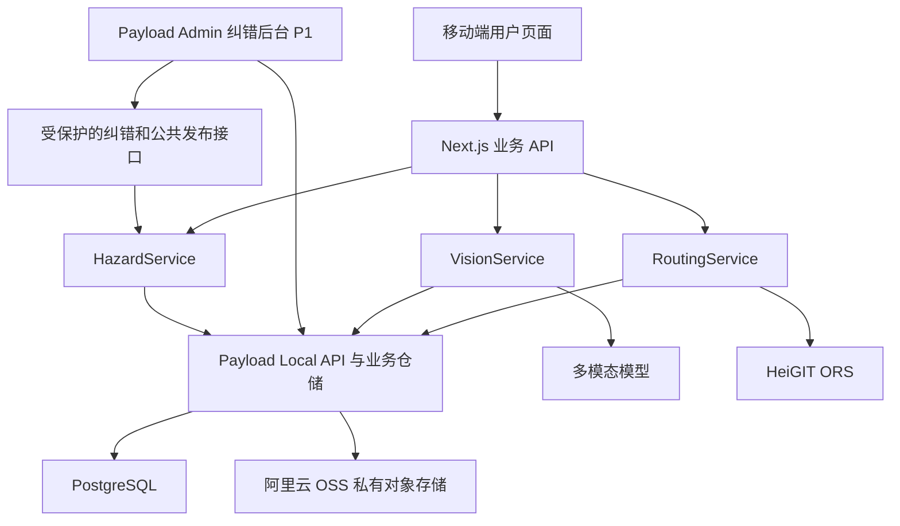

# AccessLoop 开源后端与后台选型调研

核对日期：2026年10月17日。

选型状态：用户已确认采用 **Payload 与阿里云 OSS**。本文保留候选比较作为决策依据，当前执行方案为 Next.js + Payload + PostgreSQL + 阿里云 OSS 私有对象存储，管理后台采用 Payload Admin。接入设计以[技术文档 v1.2](AccessLoop_技术文档_v1.0.md)为准，尚未安装依赖或完成部署验证。

依据：[最新需求文档](AccessLoop_需求文档_v1.0.md)、[最新技术文档](AccessLoop_技术文档_v1.0.md)。本文记录官方资料核对与工程选型建议，未执行依赖安装或 Zenith 部署验证。

## 1 推荐结论

**已确定采用 Payload 一体化方案：Next.js + Payload + PostgreSQL + 阿里云 OSS 私有对象存储，直接使用 Payload Admin。** 保留 Next.js Route Handlers 和现有业务服务；Payload 数据层与访问控制纳入 P0，公共核实与纠错后台保持 P1。

| 使用目标 | 推荐组合 | 选择理由 | 主要代价 |
| --- | --- | --- | --- |
| 已选：后端数据层和后台一起现成 | Next.js + Payload + PostgreSQL + 阿里云 OSS 私有对象存储 | 一个 TypeScript 项目内提供数据管理和后台，减少通用 CRUD 工作 | 要按 Payload 定义数据模型，并适配业务权限、事务和 OSS |
| 备选：自行实现数据层 | Next.js Route Handlers + PostgreSQL + 私有对象存储；P1 加 Refine | 保留单应用部署与既定接口 | 当前未采用；数据访问、会话与业务接口仍需编码 |
| 已有熟练 Nest 团队或可用模板 | Next.js + NestJS + AdminJS + PostgreSQL | 独立业务 API 与按数据模型生成的后台 | 增加服务边界、部署和适配器兼容工作 |

Payload 为用户已确认的执行方案，其余组合保留为备选记录；比较是结合 AccessLoop 的工程判断，不是框架性能排名。Payload 的集成功能、Refine 的 Next.js 支持及 AdminJS 的 Nest 插件分别见[官方 Payload 介绍](https://payloadcms.com/docs/getting-started/what-is-payload)、[Refine Next.js 文档](https://refine.dev/core/docs/routing/integrations/next-js/)、[AdminJS 插件列表](https://docs.adminjs.co/installation/plugins)。

## 2 最新需求对选型的影响

当前文档已明确以下基线：

1. 图片输入、模型 JSON Schema 输出和服务端语义校验属于 P0。
2. 上报者确认位置和通道后，即可启用自己的临时避让；无需管理员逐条审批。
3. 个人避让与公共障碍分开保存、授权、增版和缓存。
4. 原图、AI 结果、报告和路线片段默认按匿名会话隔离。
5. 公共核实、争议处理和纠错后台属于 P1。
6. 采用 Next.js、TypeScript、PostgreSQL 和阿里云 OSS 私有对象存储；应用必须在 Zenith 部署。

因此，后台主要服务于纠错、公共发布、配置与排障。选型不应把个人绕行重新变成审批流程，也不应仅为 P1 后台引入额外的 P0 部署依赖。

## 3 后端框架与集成系统比较

| 候选 | 产品层级与许可证 | 现成功能 | 对当前项目的判断 |
| --- | --- | --- | --- |
| [Next.js Route Handlers](https://nextjs.org/docs/app/api-reference/file-conventions/route) | 现有全栈应用的 API 层；[MIT](https://github.com/vercel/next.js/blob/canary/license.md) | HTTP 接口、Cookie、FormData，与页面同应用运行 | 默认后端入口；无需再增加一个 HTTP 框架才能完成当前接口 |
| [Payload](https://payloadcms.com/docs/getting-started/what-is-payload) | Next.js 集成后端与管理后台；[MIT](https://github.com/payloadcms/payload/blob/v3.91.0/LICENSE.md) | 管理员认证、Collection、REST、GraphQL、上传、访问控制、迁移 | 已选；保留自定义业务服务与 Route Handlers |
| [Hono](https://hono.dev/docs/getting-started/nextjs) | Web API 框架；[MIT](https://raw.githubusercontent.com/honojs/hono/v4.13.13/LICENSE) | 路由与中间件，可嵌入 Next.js | 可选路由组织层；不自带后台、数据库或业务权限 |
| [NestJS](https://docs.nestjs.com/) | Node.js 应用框架；[MIT](https://raw.githubusercontent.com/nestjs/nest/v12.1.3/LICENSE) | 模块、依赖注入、控制器等结构 | 适合熟练团队及长期独立 API；当前会增加集成环节 |
| [Fastify](https://fastify.dev/) | Node.js HTTP 框架；[MIT](https://raw.githubusercontent.com/fastify/fastify/v5.12.7/LICENSE) | 插件、路由、请求校验与序列化 | 可作独立 API 备选；不自带运营后台，吞吐能力不能解除 ORS 配额 |
| [Keystone](https://keystonejs.com/) | 数据模型、GraphQL 与 Admin UI；[MIT](https://github.com/keystonejs/keystone/blob/2026-08-31/LICENSE) | 列表、关系、认证、访问控制与后台扩展 | 可行的一体化备选；当前版本的存储适配和独立服务成本更高 |
| [Strapi 5](https://docs.strapi.io/cms/intro) | Headless CMS；[社区部分 MIT，企业目录另有许可](https://github.com/strapi/strapi/blob/main/LICENSE) | 内容类型、媒体库、REST、可扩展后台、管理员 RBAC | 内容管理场景成熟；本项目采用时通常需增加独立服务和业务定制 |

NestJS 可以使用 FastifyAdapter，两者可以组合；这里按它们承担的不同层级比较。[Nest 官方说明](https://docs.nestjs.com/techniques/performance)。

### 3.1 为什么保留 Next.js 后端

当前设计已经将 HTTP 入口与 HazardService、RoutingService、VisionService、AccessService 分开。继续使用 Route Handlers，可以把现成框架用于 HTTP 和页面托管，把项目逻辑保留为可测试的 TypeScript 模块。Next.js 官方提供 Node.js 自托管方式，支持在同一应用运行页面与服务端逻辑。[Route Handlers](https://nextjs.org/docs/app/api-reference/file-conventions/route)、[自托管](https://nextjs.org/docs/app/guides/self-hosting)。

如果采用独立 NestJS 或 Fastify 服务，除了 API 代码，还需配置第二个应用的构建、端口、健康检查、日志以及同域代理或跨域会话。按当前时限，这些额外工作只有在队友已有可用模板和熟练经验时更容易回收成本。

Hono 可在同一 Next.js 进程中组织接口，但目前没有必须引入它的需求。固定稳定主版本并使用对应教程，避免将预发布版本的适配器写法混入旧版项目。[官方 Next.js 集成](https://hono.dev/docs/getting-started/nextjs)、[Hono 稳定版 v4.13.13](https://github.com/honojs/hono/releases/tag/v4.13.13)。

### 3.2 Payload 一体化方案

Payload 能从配置生成后台、数据接口和认证，并支持 Postgres；Next.js 服务端仍可通过 Local API 访问数据，因此可以让业务接口继续使用当前 `/api/routes`、`/api/analyze` 和个人避让契约。[产品能力](https://payloadcms.com/docs/getting-started/what-is-payload)、[Postgres 适配器](https://payloadcms.com/docs/database/postgres)、[Local API](https://payloadcms.com/docs/local-api/overview)。

建议分工如下：

| 交给 Payload 的工作 | AccessLoop 自己实现的工作 |
| --- | --- |
| 管理员账号和管理界面 | 匿名会话生成及归属校验 |
| Collection、列表、筛选、关系 | 用户确认、个人启停、公共核实命令 |
| 通用数据接口和迁移机制 | expectedVersion、幂等、原子增版和审计 |
| 上传与存储适配机制 | 私有图片读取授权、真实图片校验和去元数据 |
| JSON 字段及自定义 React 组件入口 | 实时模型调用、语义校验、地图通道选择与 ORS 绕行 |

需要特别处理四个集成点：

- **路径。** Payload REST 默认使用 `/api`。可改成 `/cms-api`，并同步其 Next.js catch-all 路由目录，保留现有业务 API 命名空间。[路由配置](https://payloadcms.com/docs/admin/overview#customizing-routes)、[REST 挂载规则](https://payloadcms.com/docs/rest-api/overview)。
- **权限。** Local API 默认 `overrideAccess: true`。面向用户的访问须显式执行访问控制及匿名归属检查；CMS 管理员认证不会自动识别现有匿名 Cookie 会话。[Local API 默认值](https://payloadcms.com/docs/local-api/overview)。
- **事务。** 多次 Local API 操作要共享同一 `req` 才能加入同一事务。CMS 的编辑锁、草稿或历史版本不能替代个人版本、公共版本及原子比较更新。[事务文档](https://payloadcms.com/docs/database/transactions)。
- **私有文件。** 已选阿里云 OSS 私有桶，经权限检查后代理读取或生成短期签名下载链接。优先验证 `@payloadcms/storage-s3` 与 OSS S3 兼容接口，使用 virtual-hosted 寻址、`forcePathStyle: false`；上传、读取、删除与签名下载均需实测，必要时封装 `ali-oss` 自定义适配器。图片字段和缩略图支持不能替代 UploadService 的业务校验。[Payload 存储适配器](https://payloadcms.com/docs/upload/storage-adapters)、[OSS S3 兼容范围](https://www.alibabacloud.com/help/en/oss/developer-reference/compatibility-with-amazon-s3)。

后台中的 `verified`、AI 原始结果、owner、版本、确认记录和公共几何应通过字段权限及服务端入口控制；公共发布、驳回、解除等动作调用 HazardService。只将字段设为界面只读不能保护 API。[字段访问控制](https://payloadcms.com/docs/access-control/fields)。

### 3.3 Keystone 和 Strapi 的适用边界

Keystone 的产品名仍是 Keystone 6，但已核对的正式发行对应 `@keystone-6/core` 8.1.0。core 8 的存储接口已经改变，旧教程中的内置 named local/S3 策略被移除，需按新字段接口实现存储。对需要私有照片、REST 业务契约和单应用部署的 AccessLoop，Payload 更直接。[正式发布](https://github.com/keystonejs/keystone/releases/tag/2026-08-31)、[core 8 存储变更](https://github.com/keystonejs/keystone/releases/tag/2026-07-28)。

Strapi 提供现成后台及 RBAC，支持自定义路由；但官方 Audit Logs 和 Review Workflows 属于企业功能。项目自己的 `report_events` 与状态命令仍须实现，不能假定社区版已覆盖。[Strapi 概述](https://docs.strapi.io/cms/intro)、[自定义路由](https://docs.strapi.io/cms/backend-customization/routes)、[Audit Logs](https://docs.strapi.io/cms/features/audit-logs)。

## 4 后台管理方案比较

| 后台 | 现成程度与许可证 | 后端依赖 | 适合 AccessLoop 的用法 |
| --- | --- | --- | --- |
| Payload Admin | 按 Collection 生成管理界面；MIT 核心 | Payload 数据层 | 已选；P1 扩展地图、证据详情和受保护业务命令 |
| [Refine](https://refine.dev/core/docs/) | React 后台开发框架；[MIT 核心](https://github.com/refinedev/refine/blob/main/LICENSE) | 通过 dataProvider 调用已有 API | 备选，当前未采用；自行组合报告列表、照片详情、地图及命令按钮 |
| [React-admin](https://marmelab.com/react-admin/) | React 后台框架；[MIT 社区版](https://github.com/marmelab/react-admin/blob/master/LICENSE.md)，另有企业扩展 | 通过 dataProvider、authProvider 接 API | 熟悉 MUI/React-admin 的团队可替代 Refine |
| [AdminJS](https://docs.adminjs.co/) | 根据 ORM/资源适配器生成后台；[MIT 核心](https://raw.githubusercontent.com/SoftwareBrothers/adminjs/master/LICENSE.md) | 官方列出 Express、Nest、Fastify 等插件 | 已有独立 Node API 时更合适；复杂修改使用 custom action |

**Refine 与 React-admin 提供后台 UI 和数据访问约定，数据库、文件存储、后端权限仍由应用提供。** Refine 官方支持 Next.js、可定制 dataProvider 和非标准接口，适合保留 `PATCH /api/reports/{id}/review` 这样的业务命令。其界面权限还需配合路由保护与服务端鉴权。[Next.js](https://refine.dev/core/docs/routing/integrations/next-js/)、[dataProvider](https://refine.dev/core/docs/data/data-provider/)、[访问控制](https://refine.dev/core/docs/authorization/access-control-provider/)。

React-admin 同样可在 Next.js 的 `/admin` 中集成，官方要求管理应用按客户端方式加载；其官方现成细粒度 RBAC、审计日志等属于企业扩展。可以自行实现后端授权和审计，不能把企业包列为免费社区功能。[Next.js 集成](https://marmelab.com/react-admin/NextJs.html)、[版本功能区别](https://marmelab.com/react-admin/)。

AdminJS 支持自定义 action；`isVisible` 只控制显示，实际 API 访问要使用 `isAccessible` 和服务端业务授权。v7 为 ESM，需要核对与 Nest、ORM 适配器的版本组合；官方主插件列表未列 Next.js，因此不把它当作现有 App Router 的直接接入方案。[Action](https://docs.adminjs.co/basics/action)、[ESM 说明](https://docs.adminjs.co/installation/whats-new-in-v7)、[插件列表](https://docs.adminjs.co/installation/plugins)。

### 4.1 P1 后台应提供的页面

| 页面 | 展示内容 | 修改入口 |
| --- | --- | --- |
| 报告列表与详情 | 状态、类别、来源、发现时间、当前影响范围 | 经授权的纠错命令 |
| 证据与 AI 详情 | 私有照片、模型结果、用户修改、不确定项 | AI 原始结果只读 |
| 地图与公共障碍 | 公共几何、证据来源、有效期 | 公共核实或解除命令 |
| 审计记录 | 操作者、动作、理由、时间及版本 | 追加写入，不开放通用编辑 |
| 区域配置 | bbox、预设通道、缓冲参数、演示标识 | 服务端校验后的配置接口 |
| 调用与异常概览 | ORS/AI 调用数、等待、错误、缓存命中 | 仅显示摘要，不展示密钥或私人行程 |

这些页面作为 Payload Admin 的 P1 扩展范围，调用与异常概览按时间安排。P0 的用户侧照片分析、位置及通道确认、个人绕行继续使用专门的移动端页面。

## 5 Supabase 与 Directus 的处理

### 5.1 Supabase 可作为数据服务

用户已确认照片使用阿里云 OSS，Supabase Storage 不作为当前照片存储方案。Supabase PostgreSQL 仍可作为数据库托管候选，具体供应商取决于部署验证；业务后台继续使用已确定的 Payload Admin。

Supabase 提供 PostgreSQL、Auth、Storage、数据 API 与 Studio，其主仓库为 Apache-2.0，组合服务适用各自许可证。Studio 是数据库与项目管理控制台，运营纠错仍应通过业务后台完成。[官方自托管文档](https://supabase.com/docs/guides/self-hosting/docker)、[主仓库许可证](https://github.com/supabase/supabase/blob/master/LICENSE)。

当前自托管官方参考配置：全组件最低 2 核、4 GB RAM、40 GB SSD；建议 4 核、8 GB 以上 RAM、80 GB 以上 SSD，还需另计 Next.js 与图片处理。完整自托管会增加多个服务、持久化和备份工作，因此不作为比赛的默认前提。使用托管数据服务则先确认比赛允许、Zenith 可出网以及连接方式。[官方资源要求](https://supabase.com/docs/guides/self-hosting/docker)。

连续多次 Supabase REST 写入不能自动组成跨表事务；报告确认、审计和版本需要在服务器数据库事务或受控数据库函数中原子完成。[数据库函数](https://supabase.com/docs/guides/database/functions)。

### 5.2 Directus 不纳入本轮严格开源主推荐

Directus 有现成数据后台和地图相关功能，但已核对的稳定版 12.5.0 使用 MSCL-1.0-GPL，官方 FAQ 将当前产品描述为 source-available、当前非开源，具有许可证与激活条件。因此不能继续按旧教程将其描述为普通 MIT 类开源产品，也不能直接套用旧 BSL 的说明。本轮优先选择许可边界更直接的开源核心。[固定版本许可证](https://github.com/directus/directus/blob/v12.5.0/license)、[官方 FAQ](https://directus.com/oig/faq)。

PocketBase 也未列入主推荐：它是真实 MIT 开源且有现成控制台，但使用 SQLite，与本项目已确定的 PostgreSQL 数据基线不同，会增加迁移与重写成本。这不是因为 SQLite 缺少事务。[官方介绍](https://pocketbase.io/docs/)、[数据库 FAQ](https://pocketbase.io/faq/#can-i-use-database-x)、[许可证](https://github.com/pocketbase/pocketbase/blob/master/LICENSE.md)。

## 6 稳定版本与部署验证

| 项目 | 已核对的正式发行 | 使用注意 |
| --- | --- | --- |
| Payload | [3.91.0](https://github.com/payloadcms/payload/releases/tag/v3.91.0) | Node 最低版本已调整为 20.18.1；Next 16 分支 peer 范围为 `>=16.3.3 <17`，另有特定 Next 15 补丁范围；以固定 tag 元数据为准 |
| Refine | [core 5.0.12 等包发行记录](https://github.com/refinedev/refine/releases) | core、UI、router 分别版本化，需要一起核对 peerDependencies |
| AdminJS | [7.8.17](https://github.com/SoftwareBrothers/adminjs/releases/tag/v7.8.17) | ESM；核对框架与 ORM 插件；不按其他框架的新主版本推定插件已兼容 |
| NestJS | [12.1.3](https://github.com/nestjs/nest/releases/tag/v12.1.3) | 正式发行可选；与 AdminJS 的组合尚未安装验证 |
| Fastify | [5.12.7](https://github.com/fastify/fastify/releases/tag/v5.12.7) | 使用稳定主版本及相应插件 |
| Hono | [4.13.13](https://github.com/honojs/hono/releases/tag/v4.13.13) | v5 RC 不作稳定推荐；当前在线文档可能采用不同 adapter 写法 |
| Keystone | [core 8.1.0 对应发行](https://github.com/keystonejs/keystone/releases/tag/2026-08-31) | 与产品名 Keystone 6 区分；不要混用旧 S3 存储教程 |

Payload 的具体 Next peer 范围可在[固定 tag 的包元数据](https://github.com/payloadcms/payload/blob/v3.91.0/packages/next/package.json)中核对。最低 Node 版本是兼容下限，实际部署应选平台提供且满足全部依赖要求的运行时。

Zenith 官方发布流程要求公开仓库、`zenith-compose.yml`、介绍和图片并提交审核。本次尚未取得比赛模板的完整资源、网络及存储配置，不能直接承诺某个组合已可部署。[Zenith 开发者说明](https://zenith.hosting/developers)。

正式接入前应完成：

1. 固定版本和 lockfile，在目标运行时完成构建、健康检查和启动。
2. 验证 PostgreSQL 事务、OSS 私有图片上传、授权读取、删除及签名过期，重启后数据仍存在。
3. 无管理员参与完成实时图片分析、用户确认及个人绕行。
4. 用 A、B 两个匿名会话验证报告、照片、分析、routeRef 与缓存隔离。
5. 用并发修改验证 409 冲突、幂等、个人和公共版本以及配额预留。
6. 若开放 P1 后台，验证通用 CRUD、默认 API、文件 URL 和后台操作均不能绕过业务命令。

## 7 已确认的落地组合

**执行组合：Next.js + Payload + PostgreSQL + 阿里云 OSS 私有对象存储，管理后台使用 Payload Admin。** 保留业务 Route Handlers，模型与 ORS 由服务端模块调用，个人流程不依赖后台。

Payload 提供数据模型、管理员认证、通用数据访问、上传适配和后台；AccessLoop 服务继续负责业务命令、权限、版本、几何、配额和缓存。P0 接通数据层与私有上传，P1 补齐后台公共核实及纠错命令。不再额外引入 Refine、AdminJS 或第二套 CMS。

Payload 接入后，实时 AI、匿名归属、个人和公共状态、几何生成、共享上游预算与会话隔离仍是 AccessLoop 需要开发和验收的核心。
