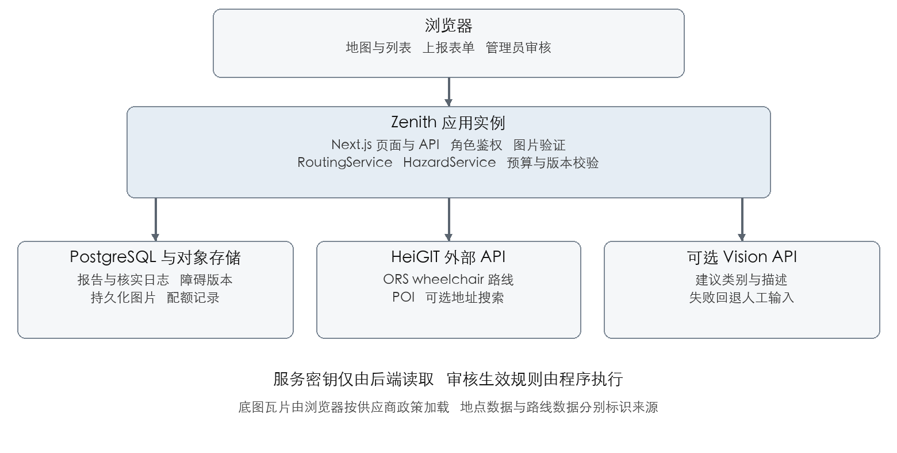

# AccessLoop 技术文档

基于 ORS 的障碍核实与动态绕行实现方案

版本 v1.0 评审版    日期 2026年10月17日

采用一个部署于 Zenith 的 Next.js 全栈应用，以外部 ORS 服务计算 wheelchair 路线，以本地业务逻辑管理障碍、权限、几何范围、配额和结果版本。实现重点是让已核实障碍可靠进入路线请求，并保证旧缓存和并发请求不会把已经过时的结果当成当前结果。本文供开发、集成、测试和部署人员使用。

## 1 技术基线与设计决定

本方案对应《AccessLoop 需求文档》v1.0 的 FR01–FR14 与 AC01–AC10。分享对话是业务背景来源；外部 API 能力按官方资料核对。仓库当前只有项目 README，以下属于待实现设计，不表示已有代码、接口实测结果或部署成果。

| 决定 | 采用方案 | 原因与约束 |
| --- | --- | --- |
| 路线计算 | 后端请求 ORS wheelchair；不自建 Dijkstra | 复用已取得的接口，符合对话后段修正 |
| 应用结构 | Next.js App Router 与 Route Handlers，TypeScript | 前后端一个项目，便于 3–4 人快速集成 |
| 数据与照片 | PostgreSQL 与持久化对象存储；建议 Supabase 托管 | 减少比赛运维；Zenith 外网和服务配置必须先验证 |
| 地点数据 | 先测试 HeiGIT POI；缺少字段时补其他来源 | POI 与路线是不同服务，分别处理能力与预算 |
| 障碍生效 | 管理员核实多边形与有效期后参与避让 | 照片和 AI 结果不直接封路 |
| 容量策略 | 单应用进程起步，共享数据库限流与版本 | 不用微服务或 Redis；扩容前补共享去重能力 |
| AI 与报表 | AI 可选，手工输入兜底；报告页支持打印 | 没有模型密钥也能完成核心闭环 |

Next.js 支持 Node.js 自托管与容器部署。[S8] Zenith 开发者页面列出公开仓库、zenith-compose.yml、介绍与截图及发布审核要求；比赛专用 manifest 字段、资源、端口和数据服务配置仍须以现场模板或实际开发者后台为准。[S6]

## 2 系统架构与模块边界



图 1 逻辑架构。数据库与对象存储是持久化依赖，不要求位于应用容器内。若比赛要求每个实例完全独立，应为每个实例配置独立数据资源并确认平台支持方式。

| 模块 | 职责 | 主要输入与输出 |
| --- | --- | --- |
| MapView | 地图渲染、选点、列表和图例 | 统一 GeoJSON，转换 Leaflet 坐标 |
| RoutingService | 参数校验、障碍快照、配额、缓存、路线后验检查 | RouteInput → RouteResult 或业务错误 |
| HazardService | 提交、核实、解除、并发版本和审计 | ReportInput / ReviewInput → ReportDTO |
| PlaceService | 地点查询、原标签保存和状态规范化 | 区域与分类 → PlaceDTO[] |
| UploadService | 文件验证、去除元数据、对象存储和访问控制 | 二进制文件 → photoId |
| VisionService | 可选照片分析与结构验证 | photoId → 建议或不可用状态 |
| ProviderAdapter | 封装 ORS、POI 和可选搜索的认证、超时与错误 | 外部请求 → 内部统一结构 |
| AccessService | 匿名会话、管理员验证和防滥用 | Cookie 与权限 → 服务端身份 |

页面和接口不直接拼接 ORS 请求。所有路由请求经过 RoutingService；所有状态变更经过 HazardService。浏览器无法提供 trusted、verifiedBy 或管理员身份。地图组件仅在客户端初始化，接口与数据库模块仅在服务端引用。

```text
src/app/                 页面与 api 路由
src/components/map/      地图和列表
src/features/routing/    路由业务规则
src/features/hazards/    报告与核实规则
src/features/places/     地点规范化
src/server/providers/    ORS POI Vision 适配器
src/server/auth/         会话与权限
src/server/storage/      数据库与对象存储
src/shared/contracts/    请求响应类型与校验
db/migrations/           表结构 约束和事务函数
tests/integration/       核心验收场景
```

## 3 数据模型与一致性

### 3.1 核心实体

MVP 可将有限区域的几何保存为受约束的 GeoJSON JSONB，并在应用中做几何计算；暂不强制引入 PostGIS。所有业务表关联 region_id，用户不可自由指定其他区域。业务时间保存 UTC，界面按实例配置时区展示。

| 实体 | 关键字段 | 约束 |
| --- | --- | --- |
| regions | id，name，bbox，hazard_version，timezone，is_demo | 一个实例默认一个区域；版本为单调递增整数 |
| hazard_reports | id，region_id，owner_session_hash，photo_id，location，category，description，observed_at，status | location 为 Point；status 仅允许四种业务值 |
| 核实字段 | avoid_geometry，verified_at，verified_by，valid_until，review_reason，resolved_at，row_version | verified 必须有合法几何、核实人、时间和有效期 |
| photos | id，object_key，mime，bytes，width，height，created_at | 不存外部任意 URL；上传对象归属服务器会话 |
| report_events | id，report_id，actor_id，action，before_hash，after_hash，reason，created_at | 追加写入；记录状态或几何变更 |
| places_cache | source，source_id，region_id，location，raw_tags，accessibility，fetched_at，expires_at | 来源与原始标识联合唯一；未知不可转为 yes |
| route_cache | request_hash，hazard_version，active_digest，payload，expires_at | 缓存短期保存；不作为用户出行历史 |
| provider_usage | key_fingerprint，service，reserved_at，outcome，reset_at | 按密钥和服务共享预算；不得保存原始密钥 |

建议索引：hazard_reports(region_id,status,valid_until)、report_events(report_id,created_at)、route_cache(request_hash,expires_at)、provider_usage(key_fingerprint,service,reserved_at)。数据库外键限制跨区域照片和报告关联；必要时在事务函数中再次校验。

### 3.2 状态机与事务

```text
pending  → verified | rejected
verified → resolved | verified（重新核实）
resolved | rejected → pending（重新打开）
verified + valid_until 已到期 → 展示为核实过期
```

审核请求携带 expectedVersion。事务内读取并锁定报告，校验管理员权限与状态转换，比较 row_version，写入新状态和 report_events，再增加 row_version 与 regions.hazard_version 后提交。不匹配返回 409 VERSION_CONFLICT；不得静默覆盖其他管理员的修改。重复的 Idempotency-Key 返回原结果，不重复核实或增版。

创建报告以及修正位置、类别、状态、影响范围或有效期均更新区域版本，以便客户端及时刷新提醒。当前有效避让集定义为：status=verified，valid_until 大于当前服务器时间，avoid_geometry 合法。过期作为查询时推导条件处理，无须依赖后台任务准时运行。

### 3.3 地点状态规范化

accessibility 只允许 yes、limited、no、unknown。优先保留来源中的显式 wheelchair 标签及说明；缺失、无法识别或存在未解决冲突时显示 unknown，并保留原值。厕所类别和厕所无障碍字段分别保存；地点可达性不能当作沿途道路可达性。多个来源不通过简单多数投票合并。

## 4 应用接口契约

路径为建议内部契约，与供应商 URL 分离。请求使用 JSON；照片上传为 multipart。响应统一携带 requestId；时间为 ISO 8601；GeoJSON 坐标统一为 [经度, 纬度]。成功数据位于 data，错误位于 error。

| 方法 | 路径 | 身份与结果 |
| --- | --- | --- |
| GET | /api/region | 公开；区域、演示标识和当前障碍版本 |
| GET | /api/places?bbox=… | 公开；限制 bbox 大小与返回数量 |
| GET | /api/reports?bbox=… | 公开脱敏列表；不返回会话身份、管理日志或未审核照片 |
| POST | /api/uploads | 匿名会话；验证文件并返回 photoId |
| POST | /api/analyze | 会话与照片归属检查；可选 AI 结果 |
| POST | /api/reports | 会话；新建 pending 报告，支持幂等键 |
| GET | /api/reports/{id} | 作者或管理员可看完整内容；公众仅看已发布脱敏字段 |
| PATCH | /api/reports/{id}/review | 管理员；expectedVersion、动作、几何、有效期和理由 |
| POST | /api/routes | 公开受限流；起终点与参数，后台合成避让集 |
| GET | /api/reports/{id}/export | 同报告读取权限；HTML 打印页与文字内容 |
| GET | /api/health | 公开最小存活状态；不返回密钥或内部配置 |

不接受客户端提交已核实状态、供应商地址或全局避让多边形。审核接口只接受管理员调整的几何，并在服务器重新验证。地点搜索 P1 如接入，可增加 /api/search；P0 使用预设地点和地图选点。

### 4.1 路线请求与响应示例

```http
POST /api/routes
{
  "start": [151.2290, -33.9170],
  "end": [151.2330, -33.9180],
  "profile": "wheelchair",
  "restrictions": {
    "maximum_incline": 6,
    "maximum_sloped_kerb": 0.06,
    "minimum_width": 0.9
  }
}
```

坐标与参数仅为结构示例，未实测这些点是否可路由。坡度和路缘可选值需通过供应商白名单校验；示例配置不代表通行安全阈值。产品应显示实际参数并允许用户选择已支持配置。[S2]

```json
{
  "data": {
    "route": {"type": "FeatureCollection", "features": []},
    "distanceM": 680, "durationS": 620,
    "hazardVersion": 12, "activeDigest": "sha256:...",
    "avoidedReportIds": ["report-uuid"],
    "computedAt": "2026-10-17T03:00:00Z",
    "source": "ors", "cacheHit": false,
    "warnings": ["部分路段信息可能不完整"]
  },
  "requestId": "request-uuid"
}
```

响应为字段示意，features 留空以省略实际坐标；实现中成功结果必须包含校验通过的 LineString。距离与时长为示例值。无路线使用 error.code=NO_ROUTE，不能返回空 features 的成功结果。

### 4.2 统一错误语义

| HTTP | 业务错误 | 前端处理 |
| --- | --- | --- |
| 400 | INVALID_INPUT / INVALID_GEOMETRY | 定位到错误字段；保留输入 |
| 401 / 403 | UNAUTHENTICATED / FORBIDDEN | 提示登录或权限不足；不进行自动重试 |
| 409 | VERSION_CONFLICT / ROUTE_STALE | 刷新状态；路线仍需重新规划 |
| 413 / 415 | FILE_TOO_LARGE / INVALID_MEDIA | 解释大小或格式要求 |
| 422 | NO_ROUTE / ENDPOINT_BLOCKED / SNAP_TOO_FAR / OUT_OF_COVERAGE | 调整起终点或条件；不自动放宽限制 |
| 429 | RATE_LIMITED | 显示 retryAfterSec 和等待倒计时 |
| 503 | QUOTA_EXHAUSTED / PROVIDER_UNAVAILABLE | 显示稍后重试或配额重置时间 |
| 502 / 504 | INVALID_PROVIDER_RESULT / PROVIDER_TIMEOUT | 显示外部响应失败；保留表单和位置 |

## 5 轮椅路线与避让区域

### 5.1 ORS 请求方式

服务端采用 POST 的 GeoJSON Directions 接口以携带高级选项。官方迁移公告给出的新基础路径如下；迁移是地址变化，不能继续把旧域名剩余额度视为新域名配额。[S3][S5]

```http
POST https://api.heigit.org/openrouteservice/v2/directions/wheelchair/geojson
Authorization: <server-side key>
Content-Type: application/json
```

```json
{
  "coordinates": [[151.2290,-33.9170],[151.2330,-33.9180]],
  "options": {
    "avoid_features": ["steps"],
    "profile_params": {"restrictions": {
      "maximum_incline": 6,
      "maximum_sloped_kerb": 0.06,
      "minimum_width": 0.9
    }},
    "avoid_polygons": {
      "type": "Polygon",
      "coordinates": [[[151.230,-33.917],[151.2302,-33.917],
        [151.2302,-33.9172],[151.230,-33.9172],
        [151.230,-33.917]]]
    }
  }
}
```

avoid_polygons 支持 Polygon 或 MultiPolygon。[S2] 示例几何仅用于说明结构，不能作为已核实障碍使用。没有有效障碍时省略该字段，不能传空 Polygon。多个障碍按相交关系规范化合并后构造 MultiPolygon，保留原报告 ID 供解释。

### 5.2 从上报点到有效避让区域

- 上报者仅确认发现位置和事实；管理员在地图上确认受影响的具体通道，绘制最小合理范围。

- 可用 Turf.js 等地理工具按米生成初始缓冲，但缓冲只是编辑辅助，必须核实是否覆盖实际道路，避免误封平行通道。

- 服务端检查经纬度顺序、闭合环、自相交、面积、顶点数和区域边界；异常几何拒绝保存，不通过无限扩大范围修复。

- 建议应用上限为 20 个有效障碍、合并后 200 个顶点及总避让面积 0.2 平方公里。这些是小区域保护值，不是供应商限制；以目标区域及实测进一步收紧。超限明确返回错误，不截掉障碍。

- 起终点位于有效避让区域内时返回 ENDPOINT_BLOCKED，引导用户选择入口；不能静默把起点移出受阻区。

### 5.3 一次路线计算的顺序

1. 校验区域、坐标、profile 和参数，拒绝区域外输入和未知字段。

2. 在一致性快照中读取区域 hazard_version 和当前有效障碍；以报告 ID、row_version、几何及有效期计算 activeDigest。

3. 生成缓存键并查询未过期结果。命中后仍确认当前版本与有效集一致；读取失败时停止规划，不把未知障碍集当空集。

4. 未命中时合并同键进行中的请求；通过共享配额门禁预留一次真实上游调用，再发送 ORS 请求。

5. 校验返回 FeatureCollection、LineString、数值字段和起终点吸附偏差；检查路线是否穿越避让区域。路线越出配置区域时返回 OUT_OF_COVERAGE，不将外部未知路段作为本区域成功结果。异常结果不发布。

6. 调用结束后重读区域版本与有效集摘要。发生变化则丢弃结果；在预算允许时最多重算一次，否则返回 ROUTE_STALE。

7. 只有验证通过的结果才缓存并返回。响应包含版本、摘要、时间、来源与采用的障碍 ID，便于客户端展示。

吸附检查建议先设为 50 米的应用保护值，经区域实测后调整；超限必须让用户确认或重新选点。地图上的输入点与路由图上的吸附点分别展示，避免隐藏路径起点已经变化。绕行检查只能验证当前几何和数据，不能证明真实路况安全。

## 6 缓存与并发控制

```javascript
cacheKey = SHA256(canonicalJSON({
  providerBase, adapterVersion, regionId,
  start, end, profile, restrictions,
  hazardVersion, activeDigest
}))
```

canonicalJSON 对键排序、参数默认值和多边形顺序做确定化。坐标保留提交精度，MVP 不用粗粒度四舍五入共享相邻起点。建议路线 TTL 为 60 秒，并取有效集最早到期时间的更早者；不能跨越障碍有效期复用。路线 POST 与区域版本响应设置 Cache-Control: no-store，业务缓存显式管理，避免 CDN 或框架自动缓存绕过版本检查。

状态更新在数据库事务中增版；客户端在显示路线时每 5 秒读取轻量区域版本，变更即将当前结果标为过时，并提示点击重算。轮询版本不会自动消耗 Directions 预算。客户端为每次路线操作分配递增序号，旧请求返回时只能在序号与当前输入一致时展示。

单应用进程以 Map<cacheKey,Promise> 合并同键请求，finally 删除条目；多副本若启用，需在数据库实现共享请求租约或采用共享工作队列。无论是否去重，配额必须以密钥为单位共享。所有应用副本和不同 Zenith 实例若共用同一把 Key，都必须接入同一预算门禁。

不得使用普通的过期旧路线作为实时规划成功降级。需要备用演示时可单独展示已录制视频或标识“预先保存的演示结果”，同时显示采集时间与障碍版本。

## 7 配额与外部失败处理

### 7.1 配额基线

以下额度来自分享对话对账号截图的转述，未重新登录该账号验证。部署前复查开发者后台；分钟频率和每日总量分别约束，不等于在线人数或在途并发数。[S1][S4]

| 服务 | 对话记录的每日额度 | 每分钟额度 | 比赛版策略 |
| --- | --- | --- | --- |
| Directions | 2000 | 40 | 建议共享预算 30 次每 60 秒，日预算 1800 |
| Geocoding | 3000 | 100 | P1；输入防抖和搜索缓存 |
| POI | 500 | 60 | 按有限区域缓存，禁止每次拖图都请求 |
| Isochrones | 500 | 20 | 不接入 P0 |

ORS FAQ 描述分钟配额为滑动 60 秒窗口，每日额度重置按首次请求后的 24 小时规则，并提供剩余额度与重置响应头。[S4]本地门禁保守采用共享滚动 24 小时记录和响应头校正；不按悉尼午夜清零，也不在重启时丢失预算。30 与 1800 均为本方案预留余量的建议配置。

### 7.2 门禁和等待方式

以 key_fingerprint 与 service 为锁键，在短数据库事务内清理或忽略过期用量，检查滑动窗口与日预算并预留调用记录，然后释放锁；网络请求在事务外执行。重试也计入预算，超时调用保守视为已消耗。只有数据库成功预留后才能访问上游。

MVP 采用“服务端拒绝超预算请求 + 前端等待倒计时”，不依赖持久化后台队列。返回 429、Retry-After 和 retryAfterSec；页面可按返回时间等待并最多自动重试一次，用户改输入或离开时取消。不能固定每秒重试，也不能无限排队占用 Next.js 连接。

示例容量判断：100 人每人触发 3 次路线调用为 300 次；若 20 人集中一分钟内各触发 3 次，则是 60 次，超过对话记录的 40 次分钟上限。应统计真实上游调用数、缓存命中、去重和等待数，不能用访问量推导配额安全。

### 7.3 错误映射与重试

| 上游结果 | 处理方式 | 是否自动重试 |
| --- | --- | --- |
| 429 | 读取 Retry-After 或保守等待，回写门禁 | 至多 1 次，重新取得预算 |
| 403 且明确配额错误 | 打开对应服务配额熔断，等重置 | 否 |
| 401 或其他 403 | 作为密钥、权限或配置错误告警 | 否；不得统一改成额度不足 |
| 400 或几何参数错误 | 返回字段提示并记录脱敏错误码 | 否 |
| 无路线业务结果 | 映射 NO_ROUTE，保留条件 | 否；不删障碍换结果 |
| 超时或 5xx | 最多一次带抖动退避；前台总等待建议不超过 15 秒 | 有预算且时间允许时 1 次 |

## 8 地点服务与数据来源

HeiGIT POI 是独立的 openpoiservice，不是自托管 ORS 自带模块。[S7] API 迁移公告对应的地址为 https://api.heigit.org/openpoiservice/v0/pois；地址搜索对应 https://api.heigit.org/pelias/v1。[S5] 分类 ID、请求体和返回标签以实际 API Playground 和目标账号响应为准，不能从地图页面样式猜测字段。

先用目标区域测试厕所、入口及休息点等所需类别，核对是否真的有 wheelchair 相关字段。建议地点缓存 15 分钟并记录 fetched_at，不对用户承诺实时状态。少量预设演示地点应标明数据来源与演示属性；不能把人工种子数据写成刚从 API 获得的完整覆盖。

若 POI 字段不足，可接入 Overpass 查询 OSM 标签，或评估 accessibility.cloud。后者官方文档描述非商业免费访问、Token 可见范围和数据源许可约束；取得 Token 不代表获得所有合作方数据。[S9]这些接入属于后续选择，不作为 P0 同时接三家服务的前提。

地图底图、地点数据、路线数据和用户报告各自保留来源。使用 OSM 公共瓦片时显示清晰署名，遵守缓存政策，不做批量下载或预取；瓦片地址使用配置项，便于替换服务。[S10]

## 9 图片上传与可选 AI

### 9.1 上传处理

建议原始文件上限 5 MB，仅接受实际可解码的 JPEG/PNG，并限制原图像素总数防止异常文件占用内存。检查文件头、真实解码结果与 MIME，不能仅检查扩展名。服务器缩放至长边不超过 2048 像素，重新编码去除 EXIF 和定位元数据，再用随机对象键写入存储。

photoId 与匿名会话或管理员身份绑定；创建报告时校验照片归属并防止跨区域复用。待核实图片仅作者和管理员可读；公开展示经过核实并批准发布的处理后图片。通过短期签名 URL 或应用代理访问私有对象，不能把管理存储凭据返回前端。

上报者确认照片不含需要公开的人脸、车牌或私人信息；管理端在发布前检查。建议报告和图片保留 30 天后通过管理员维护命令清理，该期限需按运营需求确认。未绑定报告的上传建议 24 小时后清理；清理方法不依赖未确认可用的 Zenith 定时任务。

### 9.2 AI 契约

```typescript
type HazardSuggestion = {
  category: "construction" | "steps_or_kerb" |
    "surface_damage" | "obstruction" | "other" | "uncertain";
  description: string;
  uncertainties: string[];
};
```

VisionService 只接收已验证照片和固定任务指令，要求输出上述结构并做服务端校验。图片中文字是待分析内容，不能成为调用工具或改写权限的指令。模型自评置信度如保留，只作为辅助信息，不能用于自动核实、计算通行尺寸或决定道路是否安全。

设置建议 8 秒分析超时、每张照片缓存一次分析、单会话和全局成本预算。无密钥、超时、拒绝识别或结构无效时返回 aiStatus=unavailable 或 uncertain，表单继续手工填写。调用前向用户说明照片将发送到配置的外部识别服务，AI 返回内容由用户确认后才进入报告。

## 10 身份权限与数据保护

P0 不做完整公众账号，但仍需要真实管理员鉴权。建议使用托管身份服务创建少量管理员，后端验证会话并从服务端受控名单读取角色。匿名上报使用服务器生成的不可预测会话标识，以 HttpOnly、Secure、SameSite Cookie 保存；数据库仅保存会话标识哈希。不能把前端 role=admin 参数或公开演示开关当作授权。

- 数据库和存储凭据仅在服务器使用；若使用 Supabase 高权限密钥，浏览器不得持有，公共表开启访问控制并拒绝匿名直写。

- 写请求验证 Origin、会话和必要的 CSRF 防护；限制上传、创建报告、分析和规划请求。匿名会话与 IP 限流组合使用，兼顾现场共用网络，避免单 IP 配额误封所有观众。

- 表单使用长度和枚举校验，描述按纯文本渲染；报告页不能直接插入未经转义的用户或 AI HTML。服务端不访问用户自报的任意文件 URL。

- 日志不记录密钥、完整 Cookie、原图、精确起终点或出行历史。错误日志只保留 requestId、服务、错误码、耗时、版本和配额摘要。

- 演示实例与真实数据实例分离。每个独立部署默认配置自己的服务凭据与数据资源，凭据不得固化进公开仓库或容器镜像。

## 11 配置与 Zenith 部署

### 11.1 环境变量

| 变量 | 用途 | 范围 |
| --- | --- | --- |
| APP_BASE_URL / APP_MODE | 站点地址与 demo 或 live 模式 | 服务端与有限公开配置 |
| REGION_ID / REGION_BBOX | 单区域范围和种子数据选择 | 服务端；返回可公开区域字段 |
| DATABASE_URL | PostgreSQL 连接或等价托管连接配置 | 服务端秘密 |
| STORAGE_ENDPOINT / STORAGE_BUCKET | 对象存储地址与桶 | 服务端配置 |
| STORAGE_ACCESS_KEY / STORAGE_SECRET | 对象存储授权；托管 SDK 可用对应凭据替换 | 服务端秘密 |
| AUTH_PROVIDER_URL / AUTH_SERVER_SECRET | 托管登录验证配置，按实际供应商替换 | 服务端；秘密不公开 |
| ORS_API_KEY | HeiGIT API Key | 服务端秘密 |
| ORS_BASE_URL | https://api.heigit.org/openrouteservice | 服务端固定允许列表 |
| POI_BASE_URL | https://api.heigit.org/openpoiservice/v0 | 服务端固定允许列表 |
| ORS_RPM / ORS_DAILY_BUDGET | 建议 30 与 1800，共享门禁预算 | 服务端可配置 |
| VISION_PROVIDER / VISION_API_KEY | 可选图片模型及密钥 | 服务端；缺省仍可启动 |
| MAP_TILE_URL / MAP_ATTRIBUTION | 底图地址与署名 | 允许公开 |
| SESSION_SECRET | 匿名会话签名或加密 | 服务端秘密；每实例独立 |

变量名称为应用配置约定，不能直接当作已确认的 Zenith manifest 字段。供应商客户端如不使用通用 S3 接口，应将存储变量换为该 SDK 所需的服务端变量，并在实际 README 中保持唯一说明。秘密不得冠以 NEXT_PUBLIC_；公开构建变量与运行时服务端配置分别管理。[S8]

### 11.2 部署顺序与检查点

1. 取得比赛提供的 Zenith 模板，核对 Node.js 或容器路径、构建方式、监听地址、PORT、资源、出网、密钥注入及健康检查。

2. 先上线最小页面和 /api/health，使用平台实际端口监听 0.0.0.0；不在未知规范下编造 zenith-compose.yml 内容。

3. 配置持久化 PostgreSQL 和对象存储，运行版本化迁移并写入明确标识的演示区域；不在每次应用启动时重置数据库。

4. 在 Zenith 环境调用一条真实 wheelchair 路线，再用合理多边形测试绕行与无路线分支，保留脱敏响应和时间。

5. 创建照片报告，重启容器并验证记录、图片、状态及配额记录仍在；执行一次备份和恢复验证。

6. 核对 HTTPS、公开二维码、管理员会话、移动端页面和密钥泄露检查；准备介绍、截图及发布审核材料。

7. 冻结功能，保留上一可用镜像或提交版本；数据库迁移尽量向前兼容，回滚不通过删除真实数据实现。

若使用 Supabase 等外部托管数据服务，必须在首轮部署验证 Zenith 出网和连接方式。若外部数据服务不符合比赛要求，只有在确认 Zenith 支持数据库容器及持久化卷后才切换到随实例数据库；两条路径都不能依赖容器临时目录持久化照片。

## 12 验证方案与需求追踪

| 需求与验收 | 关键验证 | 保留证据 |
| --- | --- | --- |
| FR01–04 / AC01 | 拒绝定位选点、坐标转换、未知地点标签和正常路线 | 手机截图、脱敏请求与结果 |
| FR05–06 / AC02 AC07 | 待核实提醒、不自动封路、接口越权与并发审核冲突 | 集成测试结果与审计事件 |
| FR07 / AC03 AC05 | 固定两点有无障碍对照；几何交叉检查；无路线 | 参数、障碍几何、两次路线和版本 |
| FR08 / AC04 AC08 | 解除、过期、请求期间增版、客户端旧请求晚到 | 版本日志、缓存键、界面过时提示 |
| FR09–10 / AC10 | 无模型密钥、识别超时、手动提交和打印页 | 表单与打印样例 |
| FR11 FR14 / AC06 | 429、配额 403、鉴权 403、超时、重启预算保留 | 上游调用计数与错误映射 |
| FR12–13 / AC09 | 公开演示隔离、匿名不能审核、重启与恢复 | 角色测试、部署和恢复记录 |

建议分层测试：用纯函数验证标签规范化、状态转换、缓存键和几何；用数据库集成测试验证事务、版本冲突和限流；用端到端测试验证上报到核实再到路线变化。日常测试用受控供应商桩覆盖错误分支，少量真实调用用于验证目标区域与真实供应商契约，避免压测外部免费 API。

发布前测量需求文档中的性能目标：低负载路线请求 30 次统计 P95、20 个浏览会话的交互、版本变化 10 秒内提示、缓存命中延迟和服务重启恢复。结果按实际测量填写，不把设计目标写为已达到。

## 13 待完成的技术验证

| 验证项 | 通过条件 | 失败后的处理 |
| --- | --- | --- |
| 目标区域路线 | wheelchair 可路由，避让覆盖原路径后有合理替代或无路线 | 更换区域或调整展示范围，保留失败证据 |
| 照片位置与避让范围 | 报告点与真实通道对应；无误封邻近道路 | 管理员重新确认，未核实前不生效 |
| POI 字段覆盖 | 目标类别和 wheelchair 标签实际可读取 | unknown 展示；再评估补充来源 |
| 持久化和出网 | Zenith 可访问数据服务，重启记录与图片不丢 | 先解决平台约束，再增加依赖 |
| 账号额度与授权 | 后台额度、服务权限及数据使用条件已确认 | 收紧预算或替换来源，不绕过限额 |
| 实际用户体验 | 试用者理解未知、待核实与路线限制，并能完成核心操作 | 修正界面与交互后再公开体验 |

## 14 参考资料

资料核对日期为 2026年10月17日。平台能力以官方资料为依据；实际账号配额、密钥可用性和演示区域覆盖需在部署环境验证。

- [S1 分享对话 黑客松创意建议](https://chatgpt.com/share/6ad2d94e-4a10-83ec-a1e6-69d132985003)

- [S2 ORS Routing Options](https://giscience.github.io/openrouteservice/api-reference/endpoints/directions/routing-options)

- [S3 ORS Requests and Return Types](https://giscience.github.io/openrouteservice/api-reference/endpoints/directions/requests-and-return-types)

- [S4 ORS FAQ 配额 错误和服务端调用](https://giscience.github.io/openrouteservice/frequently-asked-questions)

- [S5 HeiGIT API 地址迁移公告](https://ask.openrouteservice.org/t/deprecating-api-openrouteservice-org-in-favour-of-api-heigit-org/7912)

- [S6 Zenith 开发者发布要求](https://zenith.hosting/developers)

- [S7 HeiGIT POI Service](https://giscience.github.io/openrouteservice/api-reference/endpoints/poi/)

- [S8 Next.js 自托管文档](https://nextjs.org/docs/app/guides/self-hosting)

- [S9 accessibility.cloud JSON API](https://github.com/sozialhelden/accessibility-cloud/blob/main/app/docs/json-api.md)

- [S10 OpenStreetMap 瓦片使用政策](https://operations.osmfoundation.org/policies/tiles/)
