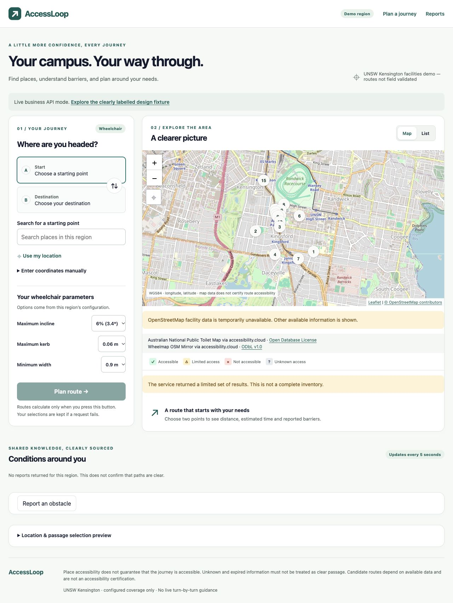

# D：真实底图与 cloud 补充设施阶段验收

2026-10-18。分支 `codex/d-backend-routing`，独立目录 `/Users/coreyli/.codex/worktrees/d-backend-routing/AccessLoop`。

- baseDevCommit：`2d85e52c7e488c706f1fad606a67ebf55ec317d2`，交付前成功 fetch，dev 未前移。
- 初始产品：`05b56d087a8d07eb380eb574664149ec86df4571`。
- 最终 headCommit / codeEvidenceCommit：`938cfc29d2b91f31102f562b5a1ffc8ff2de863c`。随后交付提交仅增加文档和证据；最终 deliveryHead、阶段 PR 与 integratedDevCommit 由实际 PR 元数据及合后回执固定。
- 阶段结果：通过。本项目 P0/P1 整体验收仍未完成。

## 实现与边界

Leaflet + 配置化 HTTPS XYZ 瓦片替换共享 MapView 的 SVG，保留现有 A/B 回调和地理图层；SSR 后加载、清理监听与 ResizeObserver、时钟推进不重绘丢失焦点、按失败瓦片跟踪告警。来源及许可均文本展示，地图与 cloud 密钥配置分离。lockfile 已锁定兼容版本。

accessibility.cloud 作为补充来源，固定官方 v2 CDN、单 tile 查询/区域过滤、原始 wheelchair boolean 和实际数据集/许可元数据映射。保留 unknown，不推导道路可通行。两个来源各用 C 的缓存/持久原子预算；缓存隔离 Token 可见范围、来源/许可与配置版本。成功设施快照每分钟刷新，公共状态仍5秒轮询。单源失败明确提示且不完整，配置/过时/持久化错误不得被吞为部分成功。字段唯一维护在 [API §4.4](../authority/API_CONTRACTS.md)。

本阶段没有改 C Collections、迁移或数据库连接层。D按用户授权整合共享地图与调用方，后续 A/B 可继续使用原 MapView props。

## 真实与离线证据

[脱敏 JSON](../deployment/map-cloud-evidence.json)保留每类调用、先前失败与清理范围；秘密和完整 Token 可见来源清单未提交。

- 真实公开 source/license 元数据 HTTP200，2149ms；选择厕所地图及 Wheelmap OSM Mirror 的 ODbL 许可来源。
- 首两次真实 places HTTP200，解析器因多语言名称对象失败（1779ms、189ms），均记真实错误。随后离线复放响应修正；新一次真实查询1603ms，Kensington bbox 15条（4厕所地图、11 Wheelmap），cloud本身 truncated=false。
- 临时生产浏览器及保留Demo入口合计6次真实POI请求，4错误（主Overpass）、2缓存命中；含上述探针，本阶段合计10次POI调用（6 cloud、4 Overpass）、6错误、2缓存命中。cloud当前key的6条持久预留清理后仍保留。没有新增ORS、Geocoding或Vision请求；并未用预算余额当统计。
- 最终生产包实际浏览器：OSM瓦片正常加载（桌面15张）；15条设施、两个数据集许可、主源不可用及不完整提示可见。地图标记选起点、列表选终点、未知事实保持unknown；没有点击Plan或调用路线。1280px及360px画布无横向溢出，移动端瓦片也正常。
- 临时测试区、会话、通道和本次cloud缓存已清理；按C正确缓存键另行核对删除。真实预算/脱敏事件保留。临时原始脚本结束时资源池未自行退出，完成清理及证据输出后终止进程；无残留3112服务。
- 保留入口 [localhost:3000/live](http://localhost:3000/live)，独立isDemo区域，无真实障碍。C初始化要求至少一条通道，首次空通道在Schema阶段拒绝；之后以明确标名的单条synthetic通道初始化。原region-unsw未替换。这里是设施/界面演示，不能计作校园通道实测。
- 正式本机入口health/live/admin登录页200；Payload匿名me为200/user=null，受保护usage-summary匿名401。

[完整桌面选点截图](screenshots/d-map-cloud-desktop.png) · [360px截图](screenshots/d-map-cloud-mobile.png)

## 命令与独立审查

- 最终 `pnpm check` exit0：ESLint、Next typegen、TypeScript通过，262通过/11默认集成跳过/0失败（共273）。本阶段新增离线测试不重复真实供应商调用。
- 最终 `pnpm build` exit0，生产bundle对应938cfc2；初始05b56d0也曾构建成功，最终浏览器已重载修复版本。
- Spec独立审查初始发现配置被吞、区域刷新失败残留旧设施、邻瓦片成功误清告警；Standards独立发现瓦片项。均补充先红后绿回归。跨VM数组断言一次因realm原型失败，改为长度断言后完整check通过，未掩盖产品失败。
- 修复头Spec离线63/63、Standards25/25，均0跳过，无剩余可操作发现；两轴范围重叠，不能相加作唯一测试数。未外呼/DB/build。
- 本地日志：`/private/tmp/accessloop-map-cloud-reviewed-check.log`、`/private/tmp/accessloop-map-cloud-reviewed-build.log`；脱敏JSON可在其他目录复核，本地日志不是外部可访问服务。

## P0/P1与部署剩余事项

本次解除“没有任何可用实时设施来源”的阻塞，主 Overpass 失败仍如实保留。cloud覆盖不是完整设施库存，未将缓存/fixture/历史录像当现场事实。付费模型能力在上一阶段已通过，不再列欠费或缺密钥。

全项目仍需校园固定起终点/通道实测、最终真实ORS/搜索/双会话公共管理浏览器闭环、人工打印/约120秒演示，以及Zenith实际项目模板/部署权限与在线恢复/入口。没有Zenith在线地址或二维码。配置及人工点击见[部署接线](../deployment/maps-and-facilities.md)和[D MANUAL](../work-packages/d-backend-routing/MANUAL.md)。
