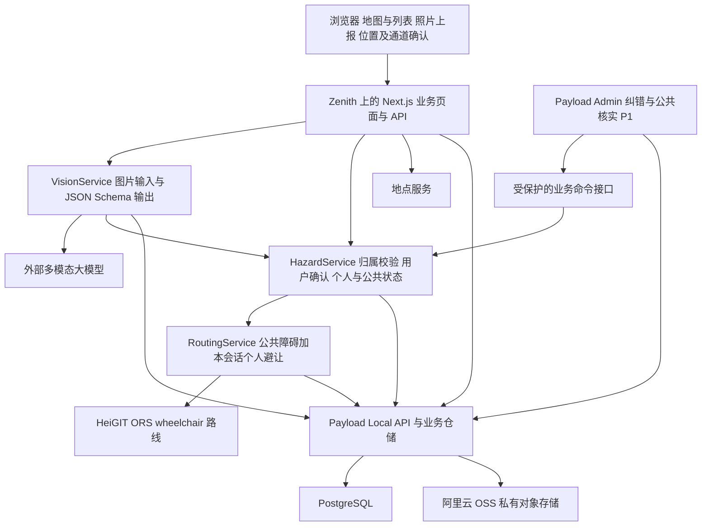

# AccessLoop 技术文档

> 当前权威入口：[文档索引](README.md)。项目决定、字段契约、协作与验收分别由 PROJECT.md、API_CONTRACTS.md、COLLABORATION.md、ACCEPTANCE.md 维护；本文保留所属范围的需求、架构或选型依据。

基于 Next.js、Payload、多模态模型与 ORS 的个人临时绕行实现方案

版本 v1.3 统一契约与四人协作版    日期 2026年10月17日

采用一个部署于 Zenith 的 Next.js + Payload 全栈应用，由 Payload 提供数据管理、管理员认证、上传适配和管理后台，以 GLM 原生图片输入、工具参数 Schema 和服务端结构/语义校验分析障碍，以外部 ORS 服务计算 wheelchair 路线。用户确认位置与通道后，后端按规则启用个人临时避让，不经过管理员逐条审批。实现重点是区分个人与公共生效范围，并保证缓存、权限和并发结果不会跨会话混用。本文供开发、集成、测试和部署人员使用。

## 1 技术基线与设计决定

本方案对应[《AccessLoop 需求文档》v1.3](AccessLoop_需求文档_v1.0.md)的 FR01–FR14 与 AC01–AC10。用户已确认使用 Payload 与阿里云 OSS；取消管理员必审，将实时 AI 图片识别及结构化输出列为 P0，人工负责异常处理与公共报告的额外核实。以下为完整业务设计；统一框架骨架已初始化，阶段结果见 [D 交接](../handoffs/wp-d.md)。Zenith 部署、外部 API 能力与目标区域仍需实测。

| 决定 | 采用方案 | 原因与约束 |
| --- | --- | --- |
| 路线计算 | 后端请求 ORS wheelchair；不自建 Dijkstra | 复用已取得的接口，符合对话后段修正 |
| 应用结构 | Next.js App Router + Payload，TypeScript；保留业务 Route Handlers | 页面、数据层和管理后台在同一个应用中运行 |
| 后端与管理后台 | 已确定 Payload 与 Payload Admin；管理员使用 Payload 认证 | 复用数据管理和后台；公共核实与纠错界面保持 P1 |
| 数据与照片 | Payload PostgreSQL 适配器 + 阿里云 OSS 私有 Bucket | 照片由阿里云托管，通过 Payload 存储适配层接入；Zenith 出网、OSS 兼容性及连接配置必须先验证 |
| 地点数据 | 先测试 HeiGIT POI；缺少字段时补其他来源 | POI 与路线是不同服务，分别处理能力与预算 |
| 障碍生效 | AI 分析后由用户确认通道，后端生成个人避让；公共生效另行核实 | 个人流程无需管理员；AI 状态不直接升级为公共已核实 |
| 容量策略 | 单应用进程起步，共享数据库限流与版本 | 不用微服务或 Redis；扩容前补共享去重能力 |
| AI 与报表 | P0 图片输入与 JSON Schema 输出，手工填报为备用路径；报告页支持打印 | AI 未接入时可启动并降级，但不计全部 P0 完成 |

Next.js 支持 Node.js 自托管与容器部署。[S8] Zenith 开发者页面列出公开仓库、zenith-compose.yml、介绍与截图及发布审核要求；比赛专用 manifest 字段、资源、端口和数据服务配置仍须以现场模板或实际开发者后台为准。[S6]

### 1.1 Payload 选型与版本基线

确定组合为 **Next.js + Payload + PostgreSQL + 阿里云 OSS 私有对象存储**。管理后台直接采用 Payload Admin；Refine、AdminJS、独立 NestJS 服务和完整 Supabase 自托管栈不纳入本版依赖。Payload 的通用能力用于数据及后台，AI、地理计算、匿名归属、业务状态、配额和缓存规则仍由 AccessLoop 服务实现。[S13]

选型调研核对的稳定版本为 Payload 3.91.0，作为接入基线；正式安装需同时核对 `payload`、`@payloadcms/next`、`@payloadcms/db-postgres`、`@payloadcms/storage-s3` 与 Next.js、React、Node.js 的兼容范围，并提交 lockfile。运行时不能仅按 Next.js 的最低要求选择，也不能把预发布版本当作稳定基线。具体版本证据见[选型调研第 6 节](AccessLoop_开源后端与后台选型调研.md#6-稳定版本与部署验证)及固定发行元数据。[S18]

OSS 使用阿里云托管的私有 Bucket，无需在 Zenith 部署对象存储服务。接入方案优先复用 `@payloadcms/storage-s3`，通过 OSS 的 S3 兼容接口访问；这是待实测的适配方案，不代表官方已保证该插件与 OSS 的全部行为兼容。OSS 要求 virtual-hosted 寻址，S3 客户端固定 `forcePathStyle: false`；endpoint、签名地域及 SDK 请求选项须按实际 Bucket 验证。[S17][S20] 若兼容测试失败，则由封装官方 `ali-oss` SDK 的 Payload 自定义存储适配器承接文件操作，继续由 `photos` Collection 管理元数据和访问控制。[S21]

## 2 系统架构与模块边界



图 1 逻辑架构。Next.js 与 Payload 集成在同一应用，管理后台直接读取仅限授权的数据视图，状态修改通过业务命令接口。个人绕行不依赖纠错后台；模型只提供图片证据分析，程序决定状态、范围与权限。数据库与对象存储是持久化依赖，不要求位于应用容器内；独立实例需配置独立数据资源并确认平台支持方式。

| 模块 | 职责 | 主要输入与输出 |
| --- | --- | --- |
| MapView | 地图渲染、选点、列表和图例 | 统一 GeoJSON，转换 Leaflet 坐标 |
| RoutingService | 合并公共与本会话个人避让、配额、隔离缓存、路线后验检查 | RouteInput 与服务器会话 → RouteResult 或错误 |
| HazardService | 提交、用户确认、个人启停、公共核实、并发版本和审计 | ReportInput / AvoidanceInput / ReviewInput → ReportDTO |
| PlaceService | 地点查询、原标签保存和状态规范化 | 区域与分类 → PlaceDTO[] |
| UploadService | 文件验证、去除元数据，通过 Payload Upload 与 OSS 存储适配层保存，控制读取 | 二进制文件 → photoId |
| VisionService | 图片输入、Schema 约束输出、语义校验与降级 | photoId → analysisId、结构化结果与 aiStatus |
| ProviderAdapter | 封装 ORS、POI 和可选搜索的认证、超时与错误 | 外部请求 → 内部统一结构 |
| AccessService | 匿名会话、Payload 管理员身份验证和防滥用 | Cookie 与权限 → 服务端身份 |
| Payload Collections / Admin | 数据模型、列表、管理员账号、上传元数据与 P1 管理界面 | 受控数据访问；敏感修改转交业务命令 |
| BusinessRepository | 封装 Payload Local API、内部表、事务和并发约束 | 服务端身份与命令 → 持久化结果 |

页面和接口不直接拼接 ORS 请求。路由请求经过 RoutingService；状态变更经过 HazardService。后端不信任浏览器提交的 AI 结果、trusted、verifiedBy 或公共核实状态，只接受归属匹配的 analysisId 和用户确认输入。地图组件仅在客户端初始化，接口与数据库模块仅在服务端引用。

```text
src/app/(frontend)/      公众页面与 api 业务路由
src/app/(payload)/       Payload 布局、admin、cms-api 及生成的后台文件
src/payload.config.ts   Payload、数据库、存储、路由与管理员 Collection 配置
src/collections/        Collection 定义、字段权限和共享校验 hooks
src/components/admin/   P1 地图、证据详情与纠错命令组件
src/components/map/      地图和列表
src/features/routing/    路由业务规则
src/features/hazards/    报告与核实规则
src/features/places/     地点规范化
src/server/providers/    ORS POI Vision 适配器
src/server/auth/         会话与权限
src/server/storage/      业务仓储、Payload 事务与私有上传封装
src/shared/contracts/    请求响应类型与校验
src/migrations/          Payload 管理的迁移及业务表、约束和事务函数
tests/integration/       核心验收场景
```

路由组名不进入 URL。业务 API 保留 `/api/*`；Payload 的 `routes.admin` 设为 `/admin`、`routes.api` 设为 `/cms-api`，并同步 REST catch-all 目录到 `src/app/(payload)/cms-api/[...slug]/route.ts`。Payload 生成的其他 API 路由如保留，也统一放在 `/cms-api` 下，避免与现有业务契约冲突。[S14]

## 3 数据模型与一致性

### 3.1 核心实体

MVP 可将有限区域的几何保存为受约束的 GeoJSON JSONB，并在应用中做几何计算；暂不强制引入 PostGIS。所有业务表关联 region_id，用户不可自由指定其他区域。业务时间保存 UTC，界面按实例配置时区展示。

| 实体 | 关键字段 | 约束 |
| --- | --- | --- |
| regions | id，name，bbox，hazard_version，config_version，timezone，is_demo，avoidance_buffer_m | hazard_version 只标记公共数据变更；缓冲宽度需按区域通道实测配置 |
| preset_passages | id，region_id，passage_version，name，geometry | 预设通道持久化；区域业务命令校验写入，旧版本不可用于新确认 |
| hazard_reports | id，region_id，owner_session_hash，photo_id，analysis_id，location，category，description，observed_at，status，row_version | status 为 pending、ai_assessed、verified、resolved 或 rejected；保留用户修正 |
| ai_analyses | id，photo_id，owner_session_hash，image_hash，model，prompt_version，schema_version，ai_status，result，created_at | 原始模型结果不可由客户端覆写；与照片及分析配置绑定 |
| personal_avoidances | report_id，owner_session_hash，confirmed_path，avoid_geometry，decision_source，observed_at，confirmed_at，valid_until，active，confirmation_report_version | 记录 ai_user_confirmed 或 user_manual；确认匹配报告版本，仅影响本会话 |
| public 核实字段 | public_revision，public_snapshot，public_avoid_geometry，verification_source，verified_at，verified_by，valid_until，review_reason，resolved_at | verified 需独立证据、合法公共几何和有效期；建议 24h |
| session_contexts | region_id，owner_session_hash，personal_version | 区域与会话联合唯一；个人变更只增加本会话版本 |
| route_snapshots | route_ref，owner_session_hash，region_id，geometry，created_at，expires_at | 路线片段选择的短期凭据，建议保留 15 分钟，不作长期行程历史 |
| photos | id，region_id，purpose，owner_session_hash，owner_admin_id，object_key，mime，bytes，width，height，created_at | report 绑定匿名会话；review_evidence 绑定管理员；用途与归属按统一 API 校验，不存外部任意 URL |
| report_events | id，report_id，actor_id，actor_role，action，before_hash，after_hash，before_version，after_version，context_versions，reason，created_at | 追加写入；状态/几何及足够后台展示的版本与理由 |
| places_cache | source，source_id，region_id，location，raw_tags，accessibility，fetched_at，expires_at | 来源与原始标识联合唯一；未知不可转为 yes |
| route_cache | request_hash，scope_key，hazard_version，personal_version，active_digest，payload，expires_at | 公共几何可共享；含个人避让的结果按会话隔离；不缓存会话凭据 |
| provider_usage | key_fingerprint，service，reserved_at，outcome，reset_at | 按密钥和服务共享预算；不得保存原始密钥 |

建议索引：hazard_reports(region_id,owner_session_hash,status)、personal_avoidances(owner_session_hash,active,valid_until)、report_events(report_id,created_at)、route_cache(scope_key,request_hash,expires_at)、provider_usage(key_fingerprint,service,reserved_at)。事务内校验报告、照片、分析与路线片段的会话及区域归属；公共几何和个人几何分别保存。

Payload 数据映射如下；上表为业务逻辑名称，实际 SQL 表名、字段名和索引以版本化迁移为准，不假定与 Collection slug 相同。

| Payload Collection / 持久化位置 | 对应实体与用途 | 后台及默认接口边界 |
| --- | --- | --- |
| `admins`，启用 auth | 管理账号、角色与启用状态 | 无公众注册；账号及角色管理仅限部署运营者 |
| `regions` | regions | 授权运营配置；涉及几何或生效集的变更经业务服务增版 |
| `preset-passages` | preset_passages | 运营者经区域业务命令配置；公众只读取合法通道DTO |
| `hazard-reports` | hazard_reports 及 public 核实字段 | 报告列表与详情；状态、归属、版本和公共几何不能通用编辑 |
| `ai-analyses` | ai_analyses | 授权只读；仅 VisionService 写入 |
| `personal-avoidances` | personal_avoidances | 授权只读排障；确认、启停和续期走 HazardService |
| `photos`，启用 upload | photos 及文件元数据 | 私有读取；写入须执行统一上传验证，不开放替代上传路径 |
| `report-events` | report_events | 授权只读；业务事务追加，不允许通用修改或删除 |
| `places-cache` | places_cache | PlaceService 管理，不作为公众自由编辑数据 |
| 内部业务表 | session_contexts、route_snapshots、route_cache、provider_usage 及幂等记录 | 通过业务仓储访问，不生成公开 CRUD |

由 `@payloadcms/db-postgres` 管理 PostgreSQL 连接，Collection 结构和内部业务表统一纳入 Payload 迁移，不再维护第二套 ORM 自动建表流程。私有关系字段的展开与文件缩略图同样执行访问控制，公开报告使用明确的 DTO 字段白名单。[S15]

### 3.2 状态机与事务

```text
pending → ai_assessed（后端接受可用的 AI 障碍分析）
pending | ai_assessed → verified（P1 独立证据与公共核实）
pending | ai_assessed | verified → rejected（P1 纠错）
verified → resolved | verified（P1 解除或重新核实）
resolved | rejected → pending（重新打开并重新确认）

个人避让独立开关：inactive → active → inactive
active 需用户明确确认、合法几何、报告版本匹配和未过期
AI 不确定或不可用时可人工填报并明确确认个人避让
个人停用不改变公共报告状态，公共 verified 不由模型写入
```

已有报告的变更携带 expectedVersion 与 Idempotency-Key，创建请求只需幂等键。事务内锁定报告，校验归属或管理权限，比较 row_version，写入确认、状态及 report_events 后增版；confirmation_report_version 绑定本次事务提交后的报告版本，避免确认写入后立即失效。个人创建、确认、停用与修正增加本会话 personal_version；公共发布、纠错、几何或有效期修正增加 hazard_version。公共纠错若同时使个人避让失效，也更新受影响的个人版本。不匹配返回 409 VERSION_CONFLICT；重复幂等键返回原结果。

自定义业务入口由 BusinessRepository 显式管理 Payload 事务；使用 `beginTransaction`、`commitTransaction`、`rollbackTransaction`，将同一 `req.transactionID` 传递给参与操作的 Local API 和 hooks，并等待所有写入完成。报告锁定或原子比较更新、内部表、审计、双范围版本与幂等结果必须加入同一数据库事务；直接 SQL 也须使用适配器对应的同一事务连接，不能另开连接后宣称整体原子。上线前用失败回滚及并发测试验证该接入点。Payload 的草稿、历史版本、编辑锁和单次操作事务不替代上述业务事务与 `row_version`。[S16]

当前请求的有效避让集为两部分的并集：公共 status=verified、未过期且公共几何合法的障碍；以及属于本会话、active=true、未过期、报告未被驳回或解决、确认版本匹配且个人几何合法的避让。pending 或 ai_assessed 均可通过明确人工确认启用个人避让，不要求管理员。不能加载其他会话的个人避让。

过期作为查询时推导条件处理，无须依赖后台任务准时运行。照片、位置或受影响通道改变后清除原确认并停用个人避让；续期必须重新确认观察时间与通道。AI 结果只关联对应照片与分析配置；过时分析不得覆盖新照片、用户编辑或个人确认。

公共读取使用经管理员认可的发布快照和独立 publicRevision；个人操作只改私有 rowVersion/个人确认，不改变公共快照或其他会话摘要。个人续期的观察时间单独记录在 personal_avoidances，不回写已发布公共事实。

P1 管理动作、预设通道版本、区域配置冲突和审计版本展示采用[项目业务规则](PROJECT.md)及[API 契约](API_CONTRACTS.md)；相关结构统一纳入 Payload 迁移，不使用通用 CRUD 绕过业务命令。

### 3.3 地点状态规范化

accessibility 只允许 yes、limited、no、unknown。优先保留来源中的显式 wheelchair 标签及说明；缺失、无法识别或存在未解决冲突时显示 unknown，并保留原值。厕所类别和厕所无障碍字段分别保存；地点可达性不能当作沿途道路可达性。多个来源不通过简单多数投票合并。

## 4 应用接口契约

全部 P0/P1 路径、HTTP 方法、请求/响应字段、状态枚举、权限、幂等/版本、错误码及示例统一维护在 [API_CONTRACTS.md](API_CONTRACTS.md)。本节不再复制另一套接口表或字段示例。

业务 /api 与 Payload /cms-api 分离，公众仅调用业务 API；后台读取可复用受保护的 Payload 视图，状态变更须走业务命令。JSON、图片和 HTML 导出各自的响应类型以 API 文档为准。

当前统一契约包含匿名会话初始化、私有照片读取、预设通道、避让预览、最终确认、文字搜索、公共管理动作、区域配置与调用摘要。预览不启用避让；确认复算并核对 previewDigest。GLM 分析与报告、个人确认及公共核实分别存储。

共享运行时 Schema 实现该契约，TypeScript 类型尽量由 Schema 推导。字段分歧作为待修复的契约差异处理，不允许四包各自决定字段名或以临时代码覆盖文档约定。变更同步文档、Schema、fixture 和调用方。负责人及跨包内部接口见[协作规则](COLLABORATION.md)。

## 5 轮椅路线与避让区域

### 5.1 ORS 请求方式

服务端采用 POST 的 GeoJSON Directions 接口以携带高级选项。官方迁移公告给出的新基础路径如下；迁移是地址变化，不能继续把旧域名剩余额度视为新域名配额。[S3][S5]

```http
POST https://api.heigit.org/openrouteservice/v2/directions/wheelchair/geojson
Authorization: <server-side key>
Content-Type: application/json
```

```json
{
  "coordinates": [[151.2290,-33.9170],[151.2330,-33.9180]],
  "options": {
    "avoid_features": ["steps"],
    "profile_params": {"restrictions": {
      "maximum_incline": 6,
      "maximum_sloped_kerb": 0.06,
      "minimum_width": 0.9
    }},
    "avoid_polygons": {
      "type": "Polygon",
      "coordinates": [[[151.230,-33.917],[151.2302,-33.917],
        [151.2302,-33.9172],[151.230,-33.9172],
        [151.230,-33.917]]]
    }
  }
}
```

avoid_polygons 支持 Polygon 或 MultiPolygon。[S2] 示例几何仅说明结构。实际几何来自有效公共障碍和本会话已确认的个人避让，与 AI 图片中的像素框分离。没有有效障碍时省略该字段，不能传空 Polygon；多个障碍按相交关系规范化合并，保留报告 ID 及个人或公共来源供解释。

### 5.2 从上报点到有效避让区域

- 上报者确认发现位置、观察时间及当前路线片段或预设通道，选择“为我临时避让”。个人生效不等待管理员。

- 路线片段通过本会话 routeRef 与首尾顶点索引引用，后端验证其属于 15 分钟内返回的路线快照；预设通道使用服务端 ID。引用过期则重新选点或规划，不接受未经核对的任意长折线。

- 后端基于用户确认的通道，以区域配置的米制宽度生成最小合理缓冲，并向用户预览确认。Turf.js 等工具负责地理计算；宽度不由照片模型猜测，也不无限扩大到邻近道路。

- 服务端检查经纬度顺序、闭合环、自相交、面积、顶点数和区域边界；异常几何拒绝保存，不通过无限扩大范围修复。

- 建议应用上限为 20 个有效障碍、合并后 200 个顶点及总避让面积 0.2 平方公里。这些是小区域保护值，不是供应商限制；以目标区域及实测进一步收紧。超限明确返回错误，不截掉障碍。

- 起终点位于有效避让区域内时返回 ENDPOINT_BLOCKED，引导用户选择入口；不能静默把起点移出受阻区。

### 5.3 一次路线计算的顺序

1. 校验区域、坐标、profile 和参数，拒绝区域外输入和未知字段。

2. 从服务器会话读取身份，在一致性快照中读取 hazard_version、该会话 personal_version 及两类有效避让。以范围、报告 ID、公共发布快照的 publicRevision 或本会话个人确认版本、几何和有效期计算 activeDigest，绝不纳入他人个人报告。

3. 生成缓存键并查询未过期结果。命中后仍确认当前版本与有效集一致；读取失败时停止规划，不把未知障碍集当空集。

4. 未命中时合并同键进行中的请求；通过共享配额门禁预留一次真实上游调用，再发送 ORS 请求。

5. 校验返回 FeatureCollection、LineString、数值字段和起终点吸附偏差；检查路线是否穿越避让区域。路线越出配置区域时返回 OUT_OF_COVERAGE，不将外部未知路段作为本区域成功结果。异常结果不发布。

6. 调用结束后重读公共版本、个人版本与有效集摘要。发生变化则丢弃结果；在预算允许时最多重算一次，否则返回 ROUTE_STALE。

7. 只有验证通过的结果才缓存。为当前会话建立短期 routeRef，响应附公共及个人版本、摘要、时间与个人或公共来源；routeRef 和个人上下文不得进入公共共享缓存。

吸附检查建议先设为 50 米的应用保护值，经区域实测后调整；超限必须让用户确认或重新选点。地图上的输入点与路由图上的吸附点分别展示，避免隐藏路径起点已经变化。绕行检查只能验证当前几何和数据，不能证明真实路况安全。

## 6 缓存与并发控制

```javascript
cacheKey = SHA256(canonicalJSON({
  providerBase, adapterVersion, regionId,
  start, end, profile, restrictions, scopeKey,
  hazardVersion, personalVersion, activeDigest
}))
```

scopeKey 在没有个人避让时为 public，此时缓存键中的 personalVersion 规范化为 0，摘要只包含公共避让；存在个人避让时使用服务器生成的会话命名空间和实际个人版本，不能由请求参数指定。公共缓存只保存可共享路线几何与公共属性，返回时单独附本会话版本及 routeRef；含个人报告的结果及进行中的 Promise 按会话隔离。模型分析缓存也按会话、照片内容哈希、模型、提示词和 Schema 版本区分。

canonicalJSON 对键、默认值和多边形顺序做确定化，坐标保留提交精度。建议路线 TTL 为 60 秒，并取个人或公共避让最早到期时间的更早者。路线、个人报告和 routing-context 响应设置 Cache-Control: private, no-store，业务缓存显式管理，避免 CDN 或框架自动缓存绕过版本与归属检查。

状态更新在数据库事务中增加对应公共或个人版本。客户端每 5 秒读取本会话 /api/routing-context，比较两个版本与当前有效集摘要；过期导致摘要变化时也将路线标为过时。轮询不调用 ORS。路线请求与 AI 分析各携带输入版本序号；旧路线不能覆盖较新结果，旧 AI 响应不能覆盖新照片或用户已修正的字段，重新确认必须绑定当前报告版本。

单应用进程以 Map<cacheKey,Promise> 合并同键请求，finally 删除条目；多副本若启用，需在数据库实现共享请求租约或采用共享工作队列。无论是否去重，配额必须以密钥为单位共享。所有应用副本和不同 Zenith 实例若共用同一把 Key，都必须接入同一预算门禁。

不得使用普通的过期旧路线作为实时规划成功降级。需要备用演示时可单独展示已录制视频或标识“预先保存的演示结果”，同时显示采集时间与障碍版本。

## 7 配额与外部失败处理

### 7.1 配额基线

以下额度来自分享对话对账号截图的转述，未重新登录该账号验证。部署前复查开发者后台；分钟频率和每日总量分别约束，不等于在线人数或在途并发数。[S1][S4]

| 服务 | 对话记录的每日额度 | 每分钟额度 | 比赛版策略 |
| --- | --- | --- | --- |
| Directions | 2000 | 40 | 建议共享预算 30 次每 60 秒，日预算 1800 |
| Geocoding | 3000 | 100 | P1；输入防抖和搜索缓存 |
| POI | 500 | 60 | 按有限区域缓存，禁止每次拖图都请求 |
| Isochrones | 500 | 20 | 不接入 P0 |

ORS FAQ 描述分钟配额为滑动 60 秒窗口，每日额度重置按首次请求后的 24 小时规则，并提供剩余额度与重置响应头。[S4]本地门禁保守采用共享滚动 24 小时记录和响应头校正；不按悉尼午夜清零，也不在重启时丢失预算。30 与 1800 均为本方案预留余量的建议配置。

### 7.2 门禁和等待方式

以 key_fingerprint 与 service 为锁键，在短数据库事务内清理或忽略过期用量，检查滑动窗口与日预算并预留调用记录，然后释放锁；网络请求在事务外执行。重试也计入预算，超时调用保守视为已消耗。只有数据库成功预留后才能访问上游。

MVP 采用“服务端拒绝超预算请求 + 前端等待倒计时”，不依赖持久化后台队列。返回 429、Retry-After 和 retryAfterSec；页面可按返回时间等待并最多自动重试一次，用户改输入或离开时取消。不能固定每秒重试，也不能无限排队占用 Next.js 连接。

示例容量判断：100 人每人触发 3 次路线调用为 300 次；若 20 人集中一分钟内各触发 3 次，则是 60 次，超过对话记录的 40 次分钟上限。应统计真实上游调用数、缓存命中、去重和等待数，不能用访问量推导配额安全。

### 7.3 错误映射与重试

| 上游结果 | 处理方式 | 是否自动重试 |
| --- | --- | --- |
| 429 | 读取 Retry-After 或保守等待，回写门禁 | 至多 1 次，重新取得预算 |
| 403 且明确配额错误 | 打开对应服务配额熔断，等重置 | 否 |
| 401 或其他 403 | 作为密钥、权限或配置错误告警 | 否；不得统一改成额度不足 |
| 400 或几何参数错误 | 返回字段提示并记录脱敏错误码 | 否 |
| 无路线业务结果 | 映射 NO_ROUTE，保留条件 | 否；不删障碍换结果 |
| 超时或 5xx | 最多一次带抖动退避；前台总等待建议不超过 15 秒 | 有预算且时间允许时 1 次 |

## 8 地点服务与数据来源

HeiGIT POI 是独立的 openpoiservice，不是自托管 ORS 自带模块。[S7] API 迁移公告对应的地址为 https://api.heigit.org/openpoiservice/v0/pois；地址搜索对应 https://api.heigit.org/pelias/v1。[S5] 分类 ID、请求体和返回标签以实际 API Playground 和目标账号响应为准，不能从地图页面样式猜测字段。

先用目标区域测试厕所、入口及休息点等所需类别，核对是否真的有 wheelchair 相关字段。地点按区域、configVersion 和适配器来源隔离，成功结果缓存 24 小时并记录 fetched_at，不对用户承诺实时状态。少量预设演示地点应标明数据来源与演示属性；不能把人工种子数据写成刚从 API 获得的完整覆盖。

公众底图按用户确认接入Leaflet 1.9.4与默认OpenStreetMap HTTPS瓦片，公开配置在前端layout仅传tile URL/纯文本署名/署名链接；不传其他环境值。保留WGS84业务几何，展示边界转换Leaflet纬经顺序；动态导入避免SSR访问window，数据刷新不重置视口，瓦片失败明确提示且保留业务图层。默认瓦片只请求当前视口，不预取或离线抓取，遵守OSM署名、浏览器缓存和Referer要求。[S24]

Overpass/HeiGIT提供主要OSM设施，accessibility.cloud按用户确认作为补充，分别通过C原子预算/持久缓存。使用固定官方v2缓存端点，Token只在服务端；经Token可见性、数据源ID和许可ID白名单过滤，保留实际来源及许可，未知或冲突事实为unknown。[S9] cloud整区域查询为一次包含bbox的XYZ瓦片请求，再按区域过滤；最多101条lookahead且响应1MiB/8秒限制。源错误与无结果区分；一个源失败可显式部分返回，全部源失败报错。缓存身份包含凭据可见范围及源/许可配置，换Token不复用旧权限缓存。不是ORS路线或公共障碍数据源，不能据设施标签直接生成避让。

当前适配器由部署配置选择：默认 Overpass，或显式 HeiGIT。Overpass 仅允许固定 HTTPS interpreter，读取 node 坐标及 way/relation 的 bbox 中心；中心是地图选点，并不证明其为真实可通行入口。查询仅取区域内厕所、休息点、入口及含 wheelchair 标签的对象，源返回最多102项，公开最多100项；源截断标记必须穿过区域过滤、去重及缓存保留。原始 wheelchair/toilets:wheelchair 缺失或冲突仍为 unknown。HTTP200 的 remark、坏坐标、非法 JSON 均按失败处理，不缓存为无结果。读取上限1 MiB、总超时8秒，门禁按该单次上限判断剩余15秒预算；公共端点不发送 ORS 密钥。源身份指纹独立计入 C 持久 poi 预算，默认10次/分钟、450次/24小时；固定全区域成功缓存避免拖图逐次请求，失败不自动切换来源。[S22][S23]

地图底图、地点数据、路线数据和用户报告各自保留来源。使用 OSM 公共瓦片时显示清晰署名，遵守缓存政策，不做批量下载或预取；瓦片地址使用配置项，便于替换服务。[S10]

## 9 图片输入与结构化 AI 分析

### 9.1 上传处理

建议原始文件上限 5 MB，仅接受实际可解码的 JPEG/PNG，并限制原图像素总数防止异常文件占用内存。检查文件头、真实解码结果与 MIME，不能仅检查扩展名。服务器缩放至长边不超过 2048 像素，重新编码去除 EXIF 和定位元数据，再用随机对象键经 Payload `photos` 上传 Collection 与 OSS 存储适配层写入阿里云 OSS 私有桶，优先验证 `@payloadcms/storage-s3` 接入。禁用本地持久化回退，缺少存储配置时明确报错；图片只可进入统一校验流程，Payload 默认上传入口及后台上传也不能绕过处理。[S17][S20]

P0 采用浏览器上传到 Next.js、后端处理后写入 OSS 的流程，存储适配器保持 `clientUploads: false`；应用使用仅能访问指定 Bucket 和对象前缀所需权限的服务端身份。Bucket 与对象均不公开，数据库记录对象键，不保存长期公开照片地址。查看时先校验匿名归属或管理员权限，再由应用代理文件，或生成建议 300 秒有效的签名链接；签名链接本身是临时访问凭证，过期后重新授权生成。模型优先使用后端读取的处理后图片字节。[S21]

photoId 与匿名会话绑定；创建报告和分析时校验归属，防止跨会话及跨区域复用。个人报告和原图默认仅作者及纠错管理员可读；模型调用使用后端读取的图片字节或受控短期地址。公共发布独立检查图片披露，不因 AI 已分析或个人避让生效就自动公开原图。通过短期签名 URL 或应用代理访问私有对象，不能把存储凭据返回前端。

Payload 文件访问必须保留访问控制，签名下载也先检查身份与归属；不使用公开桶地址或 `disablePayloadAccessControl: true` 绕过授权。`/cms-api` 文件路由、缩略图与复制出的 URL 需纳入双会话隔离验证。[S17]

调用前说明照片将发送给配置的外部识别服务，由用户明确选择分析；提示避免上传人脸、车牌或私人信息。个人流程不等待发布审核，公共图片发布在 P1 另行检查。建议报告、分析及图片保留 30 天，未绑定报告的上传保留 24 小时；期限需按运营需求确认，清理通过管理员维护命令执行，不依赖未确认可用的 Zenith 定时任务。

### 9.2 AI 契约

默认使用 glm-4.6v，后端发送处理后的照片、固定任务指令和指定结果函数的参数 Schema，提取工具参数后再做完整结构与语义校验，不执行模型要求的任意工具。无有效工具结果、非法结构、拒绝或超时明确降级；不要求视觉供应商原生严格 Schema 保证。具体字段与模型结果 Schema 统一见[API 契约](API_CONTRACTS.md)，能力背景见[项目决定](PROJECT.md)。

Schema 和结果示例在 API 文档维护，本节仅保留识别结果如何进入业务决策的规则。

visible_passage 只描述画面内可见情况，不表示整条道路的实时通行结论。模型不输出经纬度、道路精确宽度或坡度、avoid_polygons、用户角色、verified 或全局生效决策。图片中文字是待分析内容，不能作为调用工具、改写权限或更改 Schema 的指令。模型自评置信度不作为自动公共发布的依据。

后端使用 Zod、Ajv 或等价校验器再次验证完整 Schema，并检查业务逻辑：usable 图片、hazard_present=true、明确类别与 blocked 或 partially_blocked 可产生个人避让建议，仍需用户确认位置、通道和意愿才生效。null、低质量、unknown、未发现障碍或字段矛盾时，aiStatus=uncertain，报告保持 pending，不默认启用。拒绝、超时或无效结构时 aiStatus=unavailable，不把缺失字段猜成 true。[S12]

分析记录的 aiStatus 为 completed、uncertain 或 unavailable。可用障碍分析写入不可由客户端覆写的 ai_analyses，返回 analysisId；创建报告时校验其照片、会话、模型及 Schema 版本。用户修正值与模型原值分别保存。AI 响应晚到且报告版本已改变时，仅保留分析记录，不修改报告或当前确认，不能覆盖新照片、用户编辑或重新激活已停用避让。

### 9.3 个人确认与降级规则

AI 成功时展示分析结果和避让预览，用户点击“为我临时避让”才提交归属受控的确认请求。服务端验证 routeRef 或预设通道、观察时间、当前报告版本、合法几何及明确同意。观察时间不能为未来；建议 valid_until=observed_at+1 小时，已过期时需重新确认当前观察信息。用户可随时停用；续期或换照片、位置、通道必须重新确认。

AI 不确定、未发现障碍、无密钥或分析失败时，保留表单，明确提示分析状态。用户可人工填写事实、选择通道并主动确认个人临时避让，标记 decisionSource=user_manual；正常 AI 辅助确认标记 ai_user_confirmed。两条路径都不直接公共发布，也不以等待管理员作为降级出口。缺少确认或几何校验失败时不生效。

设置建议 8 秒分析超时、会话级分析缓存及单会话和全局成本预算；同照片、模型、提示词与 Schema 版本可复用，不因重绘或反复提交重复计费。模型切换、Schema 或提示词变化后重算。生产端不能用预存分析冒充实时调用；AI 未接入时可以启动及人工降级，但不计全部 P0 完成。

## 10 身份权限与数据保护

P0 不做完整公众账号，以服务器生成的不可预测匿名会话标识归属报告、分析和个人避让，使用 HttpOnly、Secure、SameSite 会话 Cookie，不设置持久 Expires/Max-Age，数据库仅保存标识哈希；刷新保留身份，关闭浏览器后不承诺找回，应用重启保持 SESSION_SECRET 稳定。个人流程不依赖管理员登录。管理账号采用 Payload 的 `admins` auth Collection，并将 `admin.user` 指向该 Collection；P1 纠错后台开放时，AccessService 在服务端验证 Payload 身份、账号启用状态和管理角色。匿名 Cookie 与 Payload 管理登录身份分开处理；可信维护方数据也需受控来源身份，不能信任客户端自报的来源或 role=admin。[S13]

- 数据库和存储凭据仅在服务器使用，公众不直接连接 PostgreSQL 或持有阿里云 OSS AccessKey；若底层选用 Supabase PostgreSQL，仅作为托管数据库连接使用，其控制台不承担业务后台职责，照片统一存入 OSS。

- Payload Local API 默认 `overrideAccess: true`。面向公众数据的读取显式使用 `overrideAccess: false`，并注入仅由服务器构造的匿名归属上下文；内部特权写入仅在业务服务完成授权和语义校验后使用，限制字段与调用位置。HTTP 请求不能自报特权上下文或 owner。REST、GraphQL、后台与执行访问控制的 Local API 调用共用 Collection 和字段权限；内部特权访问由业务仓储承担授权责任。[S19]

- `/cms-api` 不向匿名请求开放私人 Collection 的通用读写。状态、AI 原始结果、归属、版本、公共几何与审计字段不能靠后台只读界面保护；受保护命令负责修改，hooks 只承担共享校验和事务内配套写入，避免重复增版。部署运营者通过受控初始化流程建立首个管理员，关闭公众账号创建与角色提升；P1 未交付时关闭公共核实写入口。

- 写请求验证 Origin、会话和必要的 CSRF 防护，逐次核对照片、analysisId、报告及 routeRef 的归属；个人确认与公共核实分别授权。匿名会话与 IP 限流组合使用，兼顾现场共用网络。

- 表单使用长度和枚举校验，描述按纯文本渲染；报告页不能直接插入未经转义的用户或 AI HTML。服务端不访问用户自报的任意文件 URL。

- 日志不记录密钥、完整 Cookie、原图、精确起终点或出行历史。错误日志只保留 requestId、服务、错误码、耗时、版本和配额摘要。route_snapshots 仅作 15 分钟内片段确认，过期即不可读取并由维护命令清理，不能积累为行程历史。

- 演示实例与真实数据实例分离。每个独立部署默认配置自己的服务凭据与数据资源，凭据不得固化进公开仓库或容器镜像。

## 11 配置与 Zenith 部署

### 11.1 环境变量

| 变量 | 用途 | 范围 |
| --- | --- | --- |
| APP_BASE_URL / APP_MODE | 站点地址与 demo 或 live 模式 | 服务端与有限公开配置 |
| REGION_ID / REGION_BBOX | 单区域范围和种子数据选择 | 服务端；返回可公开区域字段 |
| DATABASE_URL | PostgreSQL 连接或等价托管连接配置；Zenith 预览指向内部 db:5432/accessloop | 服务端秘密 |
| ZENITH_BOOTSTRAP_EMPTY_DATABASE | Zenith 新库首次部署显式允许执行既有迁移；只在 schema 无用户对象时生效，已有库仅核对迁移集 | 服务端部署开关，非通用启动迁移 |
| POSTGRES_PASSWORD | Zenith 内部 PostgreSQL 初始化密码，须与 DATABASE_URL 一致 | 仅数据库容器秘密 |
| ADMIN_EMAIL / ADMIN_PASSWORD | 受控命令或 Zenith 一次性初始化首个 operator；已有账户不覆盖 | 服务端私有初始化配置 |
| PROVIDER_LEDGER_SNAPSHOT | 部署接管时恢复有效预留/封锁与脱敏事件的有界私有快照；不是持续同步 | 服务端私有输入；C 事务/锁恢复，不含行程或原始密钥 |
| PAYLOAD_SECRET | Payload 认证及加密密钥；与 SESSION_SECRET 分开配置 | 服务端秘密；每实例独立，重启保持一致 |
| OSS_ENDPOINT / OSS_BUCKET | 阿里云 OSS HTTPS 服务地址与私有 Bucket；Zenith 使用可连通的 endpoint | 服务端配置 |
| OSS_REGION | Bucket 所在地域；映射为所用 SDK 要求的地域及签名配置，不能照搬 AWS 地域值 | 服务端配置 |
| OSS_ACCESS_KEY_ID / OSS_ACCESS_KEY_SECRET | 仅授权指定 Bucket 和对象前缀必要操作的阿里云身份凭据 | 服务端秘密 |
| OSS_SIGNED_URL_TTL_SECONDS | 建议 300；授权后生成的文件临时访问链接有效期 | 服务端配置 |
| ORS_API_KEY | HeiGIT API Key | 服务端秘密 |
| ORS_BASE_URL | https://api.heigit.org/openrouteservice | 服务端固定允许列表 |
| POI_PROVIDER | 默认 overpass；可显式 heigit | 服务端固定选择；不接受请求代理地址 |
| OVERPASS_BASE_URL | https://overpass-api.de/api/interpreter | 服务端固定允许列表；无 ORS 凭据 |
| POI_BASE_URL | https://api.heigit.org/openpoiservice/v0；仅 heigit 使用 | 服务端固定允许列表 |
| POI_RPM / POI_DAILY_BUDGET | 默认10与450，独立 poi 服务持久门禁 | 服务端可配置 |
| ORS_RPM / ORS_DAILY_BUDGET | 建议 30 与 1800，共享门禁预算 | 服务端可配置 |
| VISION_PROVIDER / VISION_MODEL / VISION_API_KEY | 默认 glm / glm-4.6v，原生图片和工具参数提取，后端严格校验；密钥 | 服务端；缺省可启动和人工降级，不计 AI 验收完成 |
| VISION_SCHEMA_VERSION / VISION_PROMPT_VERSION | 输出契约与提示词版本，参与分析缓存键和审计 | 服务端固定配置 |
| VISION_TIMEOUT_MS / VISION_RPM / VISION_DAILY_BUDGET | 建议 8000 毫秒超时、默认 10 次/分钟；日预算须显式正整数，或显式 unlimited 仅关闭应用日上限 | 服务端；与 ORS 预算分开，unlimited 不绕过分钟门禁或上游配额 |
| PERSONAL_AVOIDANCE_TTL_SECONDS / PUBLIC_HAZARD_TTL_SECONDS | 建议个人 3600 秒、公共 86400 秒 | 服务端可配置运营值 |
| ACCESSIBILITY_CLOUD_APP_TOKEN | cloud应用Token，仅服务端固定官方HTTPS请求使用 | 服务端秘密；不得入日志、前端或地图URL |
| ACCESSIBILITY_CLOUD_SOURCE_IDS / ACCESSIBILITY_CLOUD_LICENSE_IDS | JSON字符串数组，明确数据集与许可白名单；未知许可不展示 | 服务端配置，变更隔离缓存 |
| MAP_TILE_URL / MAP_ATTRIBUTION / MAP_ATTRIBUTION_URL | 默认OSM HTTPS XYZ瓦片、纯文本署名及版权链接；自定义三项配套 | 允许公开；静态页面变更后重建 |
| SESSION_SECRET | 匿名会话签名或加密 | 服务端秘密；每实例独立 |
| TRUSTED_MAINTAINER_REFERENCES | JSON字符串数组，默认空数组，最多100个受控来源引用 | 服务端维护方名单；客户端自报不能建立可信身份 |

变量名称为应用配置约定，不能直接当作已确认的 Zenith manifest 字段。`payload.config.ts` 将 DATABASE_URL 映射到 PostgreSQL 适配器，将 OSS_* 映射到 OSS 存储适配层的 endpoint、bucket、region、credentials 及签名有效期，不能假定插件会自动读取这些应用变量。S3 兼容接入固定 `forcePathStyle: false`，保留 Payload 文件访问控制；配置由统一存储封装读取。生产环境缺少 PAYLOAD_SECRET、数据库或 OSS 必要配置时启动失败，不退回临时文件存储。秘密不得冠以 NEXT_PUBLIC_；公开构建变量与运行时服务端配置分别管理。[S8][S17][S20]

### 11.2 部署顺序与检查点

1. 取得比赛提供的 Zenith 模板，核对 Node.js 或容器路径、构建方式、监听地址、PORT、资源、出网、密钥注入及健康检查。

2. 按锁定的兼容版本构建 Next.js + Payload，先上线最小页面和 /api/health；检查 `/admin` 与 `/cms-api` 挂载且业务 `/api` 不冲突，使用平台实际端口监听 0.0.0.0；不在未知规范下编造 zenith-compose.yml 内容。

3. 配置持久化 PostgreSQL、阿里云 OSS 私有 Bucket、服务端 OSS 凭据和 PAYLOAD_SECRET；从 Zenith 验证上传、读取、删除与签名下载的实际兼容性。执行已提交的 Payload 版本化迁移，包括内部业务表与并发约束，再写入明确标识的演示区域。迁移作为受控发布步骤单次执行，生产不使用开发期自动 push 改表；不在每次应用启动时重置数据库。首个管理员由受控部署流程创建。[S15][S20][S21]

4. 在 Zenith 环境实测图片输入与 Schema 输出，再完成无管理员参与的“上报 → 用户确认 → 个人避让 → ORS 绕行”；测试无路线、AI 降级与两会话隔离，保留脱敏结果。

5. 创建照片报告并启用个人避让，重启容器后验证图片、分析、用户确认和配额记录仍在；已过期避让不能恢复生效。执行一次备份和恢复验证。

6. 核对 HTTPS、公开二维码、匿名会话归属、移动端页面和密钥泄露；验证 Payload 默认 CRUD、关系展开、上传、文件地址不能绕过授权和业务命令。若开放 P1 公共纠错接口，另测 Payload 管理鉴权、版本冲突、原子审计与公共发布证据。准备介绍、截图及发布审核材料。

7. 冻结功能，保留上一可用镜像或提交版本；数据库迁移尽量向前兼容，回滚不通过删除真实数据实现。

照片存储供应商已确定为阿里云 OSS，实际账号、地域、Bucket、权限及 Zenith 连通性尚待部署验证。PostgreSQL 托管供应商仍按部署条件确定；如使用 Supabase，仅连接其 PostgreSQL，不额外引入 Auth、Storage 与 Studio 作为本版默认架构。外部数据服务的使用条件须按比赛规则确认；当前预览按用户选择配置 Zenith 内 PostgreSQL 17.6 与命名持久卷，web/db 分离服务且仅公开 web:3000；依据官方 Compose contract/schema 配置，不代表平台持久性已验。构建与运行固定 Node 22.14.0 / pnpm 10.20.0。当前平台渲染器拒绝 `pre_start` 和输入声明，预览通过 CLI 私密 local-env 注入及容器入口顺序执行受控新库迁移、幂等初始化和 Web。新库迁移必须显式启用且 schema 无用户对象；已有库仅核对完整迁移集合，部分/不兼容库停止等待受控修复。该初始化不在每次重启执行迁移，不清表，实际数据库等待及持久性须看平台日志。同一供应商密钥接管前须停用旧账本的运行实例或改为统一原子仓储，禁止用一次快照维持两套并发预算。操作及通过范围见[预览说明](../deployment/zenith-preview.md)。OSS 或网络不可用时上传明确失败，不能回退到容器临时目录持久化照片。

## 12 验证方案与需求追踪

| 需求与验收 | 关键验证 | 保留证据 |
| --- | --- | --- |
| FR01–04 / AC01 | 拒绝定位选点、坐标转换、未知地点标签和正常路线 | 手机截图、脱敏请求与结果 |
| FR05–06 / AC02 AC07 | AI 状态由后端产生；用户确认后个人生效；越权、伪造公共状态和版本冲突 | 分析记录、用户确认与审计事件 |
| FR07 / AC03 AC05 | 无管理员完成个人绕行；第二会话不受影响；几何交叉及无路线 | 相同参数的双会话结果、障碍范围与版本 |
| FR08 / AC04 AC08 | 个人停用与过期、公共解除、请求期间增版、旧 AI 与路线结果晚到 | 双版本、隔离缓存键与过时提示 |
| FR09–10 / AC02 AC10 | Schema、语义矛盾、拒绝、超时、无密钥、人工确认备用路径与打印范围标识 | 模型样例、校验结果、表单与打印页 |
| FR11 FR14 / AC06 | 429、配额 403、鉴权 403、超时、重启预算保留 | 上游调用计数与错误映射 |
| FR12–13 / AC07 AC09 | 演示隔离、Payload 管理身份与 CRUD/文件权限、个人与公共权限、重启保留确认且过期不复活 | 归属测试、部署与恢复记录 |

建议分层测试：纯函数验证 Schema、业务逻辑、双范围有效集、缓存键和几何；数据库集成测试验证归属、事务、版本冲突与限流；端到端测试在无管理员会话下完成 AI 分析、用户确认和路线变化，并以另一会话验证隔离。日常测试用供应商桩覆盖错误分支，少量真实图片用于实测识别与契约，避免压测外部 API。

本轮按[统一验收规则](ACCEPTANCE.md)执行主流程、公共或个人变更及过期后10秒内提示、AI超时降级、缓存隔离和重启恢复；不把30次P95、20浏览会话压测或极端环境矩阵作为交付门槛。识别样例包含清晰障碍、无障碍、模糊照片及场景外通道不可见，记录误报与漏报，不把 JSON 格式正确当作识别准确。结果按实测填写。

## 13 待完成的技术验证

| 验证项 | 通过条件 | 失败后的处理 |
| --- | --- | --- |
| Payload 版本及部署集成 | 固定依赖可构建启动，`/admin`、`/cms-api` 与业务 `/api` 不冲突 | 调整兼容版本或平台配置，保持 Payload 已选方案 |
| Payload 权限与事务接入 | 默认 CRUD 不绕过规则，文件不越权，多实体失败全回滚，并发修改返回 409 | 关闭受影响入口，修复权限、事务连接与并发约束后再开放 |
| 阿里云 OSS 适配与私有访问 | Zenith 上传、读取、删除及签名下载成功；私有对象不能匿名直读，A/B 会话与缩略图隔离，签名过期失效，重启后仍可授权读取 | 修复 endpoint、签名、权限或 SDK 兼容选项；必要时改用 ali-oss 自定义适配器，继续使用 OSS |
| 目标区域路线 | wheelchair 可路由，避让覆盖原路径后有合理替代或无路线 | 更换区域或调整展示范围，保留失败证据 |
| 照片位置与避让范围 | 用户确认的点与通道一致；后端生成范围不误封邻近道路 | 让用户重新选择或缩小范围；不启用无效个人避让 |
| AI 图片与 JSON Schema | 真实图片返回有效结构；语义异常、拒绝与超时被正确降级 | 保留人工填报及明确确认路径，修正接入后重新验收 |
| 双会话隔离 | A 的个人报告不影响 B，也不被公共缓存或分析缓存泄露 | 暂停受影响接口并修复归属及缓存键 |
| POI 字段覆盖 | 目标类别和 wheelchair 标签实际可读取 | unknown 展示；再评估补充来源 |
| 持久化和出网 | Zenith 可访问数据服务，重启记录与图片不丢 | 先解决平台约束，再增加依赖 |
| 账号额度与授权 | 后台额度、服务权限及数据使用条件已确认 | 收紧预算或替换来源，不绕过限额 |
| 实际用户体验 | 试用者理解 AI 已分析、个人避让与公共已核实，能独立确认通道 | 修正界面与交互后再公开体验 |

## 14 参考资料

资料核对日期为 2026年10月17日。平台能力以官方资料为依据；实际账号配额、密钥可用性和演示区域覆盖需在部署环境验证。

- [S1 分享对话 黑客松创意建议](https://chatgpt.com/share/6ad2d94e-4a10-83ec-a1e6-69d132985003)

- [S2 ORS Routing Options](https://giscience.github.io/openrouteservice/api-reference/endpoints/directions/routing-options)

- [S3 ORS Requests and Return Types](https://giscience.github.io/openrouteservice/api-reference/endpoints/directions/requests-and-return-types)

- [S4 ORS FAQ 配额 错误和服务端调用](https://giscience.github.io/openrouteservice/frequently-asked-questions)

- [S5 HeiGIT API 地址迁移公告](https://ask.openrouteservice.org/t/deprecating-api-openrouteservice-org-in-favour-of-api-heigit-org/7912)

- [S6 Zenith 开发者发布要求](https://zenith.hosting/developers)

- [S7 HeiGIT POI Service](https://giscience.github.io/openrouteservice/api-reference/endpoints/poi/)

- [S8 Next.js 自托管文档](https://nextjs.org/docs/app/guides/self-hosting)

- [S9 accessibility.cloud JSON API](https://github.com/sozialhelden/accessibility-cloud/blob/main/app/docs/json-api.md)

- [S10 OpenStreetMap 瓦片使用政策](https://operations.osmfoundation.org/policies/tiles/)

- [S11 Gemini 图片理解 官方能力示例](https://ai.google.dev/gemini-api/docs/image-understanding)

- [S12 Gemini Structured Outputs 与应用校验](https://ai.google.dev/gemini-api/docs/structured-output)

- [S13 Payload 产品能力与集成方式](https://payloadcms.com/docs/getting-started/what-is-payload)

- [S14 Payload 后台及 API 路由配置](https://payloadcms.com/docs/admin/overview#customizing-routes)

- [S15 Payload PostgreSQL 适配器与迁移](https://payloadcms.com/docs/database/postgres)

- [S16 Payload 数据库事务](https://payloadcms.com/docs/database/transactions)

- [S17 Payload 上传与存储适配器](https://payloadcms.com/docs/upload/storage-adapters)

- [S18 Payload 3.91.0 的 Next.js 依赖元数据](https://github.com/payloadcms/payload/blob/v3.91.0/packages/next/package.json)

- [S19 Payload Local API 与访问控制默认值](https://payloadcms.com/docs/local-api/overview)

- [S20 阿里云 OSS 的 S3 API 兼容范围与寻址差异](https://www.alibabacloud.com/help/en/oss/developer-reference/compatibility-with-amazon-s3)

- [S21 阿里云 OSS Node.js SDK 与私有对象签名下载](https://www.alibabacloud.com/help/en/oss/developer-reference/download-objects-using-a-presigned-url-generated-with-oss-sdk-for-node-js)


- [S22 Overpass官方查询手册](https://dev.overpass-api.de/overpass-doc/en/criteria/per_tag.html)

- [S23 Overpass官方数据格式与center](https://dev.overpass-api.de/overpass-doc/en/targets/formats.html)

## 15 D 服务实现接线记录（2026-10-17）

实现沿用本文单应用/单仓储架构：地理函数与路线服务位于 `src/features/routing/server`，ORS/Pelias/预算门禁及脱敏摘要位于 `src/server/providers`，真实搜索位于 `src/features/places/server`。`RoutingRepository` 由 C 实现并在 Node 初始化中安装；D 不新建数据库连接，不以进程内 Map 保存生产预算。Map 只用于同键进行中请求去重。详细接线见 [D 服务交接](../handoffs/d-service-integration.md)，实际验证结果见 [D 技术验收](../acceptance/wp-d.md)。未配置仓储或密钥时不把未知有效集当空集；不会提供合成校园成功数据。

- [S24 OpenStreetMap瓦片使用政策](https://operations.osmfoundation.org/policies/tiles/)
