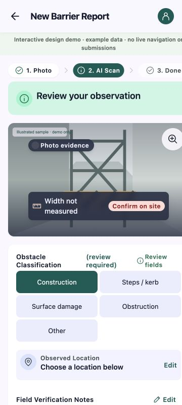

# PR #11：A0 阶段独立集成审查

日期：2026-10-17。执行：D。PR：[Stitch three-tab prototype and shared route client](https://github.com/ZMX8Z/AccessLoop/pull/11)。结论：**当前阶段未通过，保留开放，不合入dev**。

| 固定证据 | 值 |
| --- | --- |
| PR head | `3b5e8db54b1098dbd61c22acb12aca09a8b0edbd` |
| target dev / baseDevCommit | `2f38fcdc449c400dfcfbb916e2c64730a2bfcdbb` |
| merge-base | `d3e06bded36f2ca4cef98cd2a802dc633acf8a01` |
| 无冲突合并树 | `abe64e6afeab313ea7b0b721570322111ea075ac`，只在Git对象库计算，不切换分支或改变dev |
| diff | `git diff d3e06bd...3b5e8db` |
| A提交 | 050e5f1功能、a07cb47同步、0e7265c/3b5e8db交付记录 |

独立规范/需求两条审查线后，主agent实际运行合并树检查、事件处理器及浏览器复验。此PR只验声明的A0设计演示/公共客户端基础；Stitch明确Design Demo、未做A1/P1或C1本身不计A0缺陷。未修改A产品代码，未调用供应商，也未将本次算作真实业务/数据库验收。

## Standards

1. **阶段阻塞 P2：换routeRef继承旧路线索引。** [PassagePicker.tsx:26](https://github.com/ZMX8Z/AccessLoop/blob/3b5e8db54b1098dbd61c22acb12aca09a8b0edbd/src/components/map/PassagePicker.tsx#L26) 修改索引时直接沿用受控value中的起止索引，即使value.routeRef属于旧路线。API §1.3要求`0 <= startIndex < endIndex < coordinates.length`。主agent在不改源码的最小渲染桩中执行该真实onChange处理器：旧value `{routeRef:'old-route',startIndex:0,endIndex:79}`，新路线4点，修改起点后输出 `{routeRef:'new-route',startIndex:1,endIndex:79}`，结构Schema仍接受。B接入预览会提交越界引用。

   修复：只复用与当前routeRef一致且在当前长度内的索引；换路线重置选择，输出前校验完整动态上界。复验旧长路线切到新短路线及当前合法片段。

2. **非阻塞规范项：归并已发布共享Schema。** [models.ts:3–32](https://github.com/ZMX8Z/AccessLoop/blob/3b5e8db54b1098dbd61c22acb12aca09a8b0edbd/src/features/routing/client/models.ts#L3) 仍以“骨架缺少Schema”为由重建D已发布的Region/Place/Passage/Context/Route/Geometry校验，违反API §12、COLLABORATION §3单一执行来源；版本0、空几何等约束已漂移。应复用`src/shared/contracts`，只保留客户端投影和C尚未发布的必要报告校验。本次没有发现正确D响应因此被拒绝的直接用户故障，不把纯重复作为额外A0阻塞。

其余：请求同源凭据/no-store、multipart、取消及401不重放写请求；public演示资源已移除外部依赖，未见秘密或用户文本注入。没有额外需要阻止阶段合入的smell判断项。

## Spec

1. **阶段阻塞 P1：360px确认页无法滚动到提交。** [report-confirm.html:1](https://github.com/ZMX8Z/AccessLoop/blob/3b5e8db54b1098dbd61c22acb12aca09a8b0edbd/public/stitch/report-confirm.html#L1) 保留根节点`width:390px;height:1085px;overflow:hidden`。生成器未清除固定画布，app.js又在提交前追加观察表单，违反A ACCEPTANCE“360px宽度无阻塞主操作的溢出”。

   实测：360×800视口，R1 Start Journey→R2成功；进入Report、选择内置样例、继续到P2后，html宽390，body高1451，Submit顶部1261。向下滚动3页后scrollY仍0，提交按钮仍在视口外。不是仅靠源码推断。

   修复：移除生成器及生成文件的固定根宽/高和禁止纵向滚动，重新生成；复验360px下完整表单、错误提示和提交按钮可达，不只查看首屏。

   

2. **后续A1/P1风险 P2：规划后的迟到context可覆盖更新轮询。** [RoutePlanner.tsx:125–129](https://github.com/ZMX8Z/AccessLoop/blob/3b5e8db54b1098dbd61c22acb12aca09a8b0edbd/src/features/routing/client/RoutePlanner.tsx#L125) 在规划后再次读取context，再直接写入route/contextRef，未使用轮询路径已有的evaluatedAt防倒退检查。场景：该context(v1)先生成却延迟，轮询先应用v2，随后v1返回可暂时将旧路线标回Current context。对应API §3过时响应约束。该项为源码时序审查，未声称已在真实服务复现；纳入A1迟到案例复验，不作为本次A0新增合入阻塞。

规范轴2项（1阻塞/1非阻塞），最严重为跨routeRef越界索引；需求轴2项（1阻塞/1后续风险），最严重为手机提交不可达。两条审查线独立记录。

## 实际检查与后续准入

- 隔离导出上述合并树，链接已锁定依赖，未复制秘密或连接业务库。
- `pnpm check` exit0：ESLint、Next类型及TS通过；113测试通过、0失败、3默认集成测试跳过。
- `pnpm build` exit0，含/live、/preview及既有业务入口；Webpack有warnings，不声称零警告。
- 浏览器只验证隔离静态public文件和明确标记的演示数据；R1→R2及样例照片→P2可达，P2滚动缺陷已复现。未上传个人图片或创建真实报告。
- PassagePicker实际处理器最小渲染桩复现越界；没有将结构Schema通过误认为动态上界有效。
- 临时视口已恢复，测试页已关闭；dev保持原集成版本。A在固定分支修复后更新同一PR，固定新head后只复验失败项及受影响流程，再决定合入。静态构建通过不覆盖这两项功能阻塞。

## 后续修复结论（2026-10-17）

以上是原head的历史阻塞，不再代表最新PR状态。用户授权D协助后，A固定分支已修复两项阻塞与Schema/上下文问题；最终独立复审无A0阻塞，check144通过/3跳过、build exit0，360px实际保存演示记录。PR #11已合入dev `1b17f3cfb6c787fb96d0dc01f098d3f3ea9f7b14`。固定代码/交付head、截图与范围见[A验收](../acceptance/wp-a.md)。真实P0/P1仍待后续，不用演示替代。
